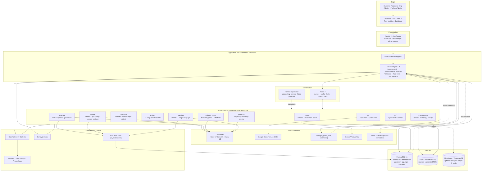
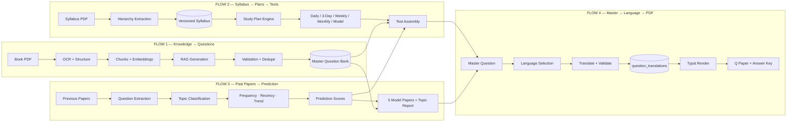
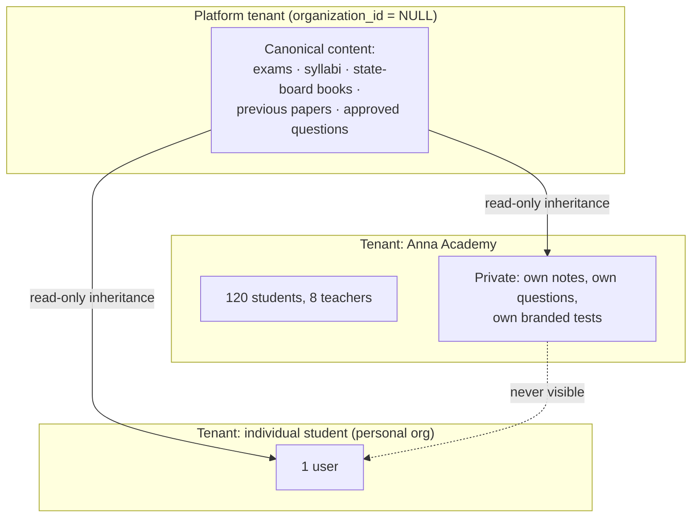
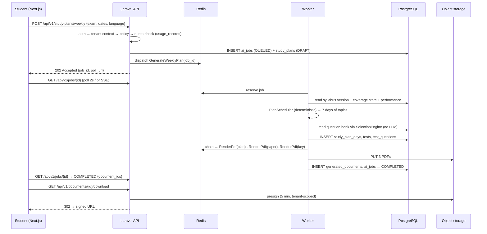

# 01 — System & SaaS Architecture

Covers required outputs **1 (system architecture diagram)**, **2 (SaaS architecture)**,
**38 (final architecture)** and **37 (why every component exists)**.

---

## 1.1 Design premise

The economics of this business are decided by one number: **AI cost per served artifact**.

A naive implementation calls an LLM when a student clicks "generate test" — cost scales
linearly with users and the platform dies at scale. This architecture instead separates
the system into two planes:

| Plane | Trigger | Latency budget | Cost | Runs |
|---|---|---|---|---|
| **Production plane** (expensive, rare) | Admin uploads a source, or a scheduled refresh | Minutes to hours | AI tokens, OCR pages | Once per source document |
| **Projection plane** (cheap, constant) | Student clicks anything | < 300 ms | ~0 | Millions of times |

Everything in §3–§13 of the spec belongs to the production plane. Everything a student
touches is a projection: a SQL query with a selection policy, plus a stored PDF.

> One 6th-standard Science book costs roughly ₹180 to ingest and ₹1,100 to convert into
> 500 approved questions. Those 500 questions then serve 50,000 students at ₹0 marginal
> AI cost. That ratio *is* the product.

---

## 1.2 Complete system architecture



### Why each component exists

| Component | Why it is required | What breaks without it |
|---|---|---|
| **Cloudflare CDN/WAF** | PDFs are the payload; egress and bot scraping are the top cost/abuse risks | Bandwidth bill, question-bank scraping by competitors |
| **Next.js** | Public exam pages need SEO; dashboards need heavy client interactivity | Either no organic acquisition or a sluggish app |
| **Laravel API (stateless)** | Business rules, tenancy, entitlement checks, job dispatch in one place | Rules leak into frontend → tenant/quota bypass |
| **Redis + Horizon** | AI jobs take 30 s–20 min; HTTP cannot hold them | 504s, lost uploads, no retries, no visibility |
| **Separate worker pools** | OCR is CPU-bound, embedding is GPU/CPU-bound, generation is network-bound | One slow book upload starves all translations |
| **PostgreSQL + pgvector** | Relational integrity (citations, mappings) *and* semantic search in one transaction | Dual-write drift between a vector DB and Postgres |
| **Read replicas** | Analytics and question-bank browsing are read-heavy | Student dashboards contend with ingestion writes |
| **Object storage** | Books are 50–300 MB; PDFs are generated by the million | Postgres bloat, unrestorable backups, slow WAL |
| **Prompt registry in DB** | Reproducibility and A/B of generation quality | Cannot explain or reproduce why a question was generated |
| **ai_invocations trace** | Cost attribution per tenant and per feature | Unbounded, unattributable AI spend |
| **PDF worker service** | Indic shaping and pagination are deterministic work | Malformed Tamil ligatures, broken answer keys |
| **ClickHouse (later)** | Per-answer analytics at 100 k users exceeds OLTP comfort | Analytics queries lock up the OLTP primary |

---

## 1.3 The four data flows



The critical property: **all four flows converge on one question bank**. Flow 2 and Flow 3
do not generate questions — they *select* from Flow 1's output using different policies.
Flow 4 does not generate questions — it *projects* them into a language. This is what makes
adding the 6th language or the 40th exam cheap.

---

## 1.4 Layered internal architecture (Laravel)

```
HTTP / Console entrypoints
  └── Http\Controllers\Api\V1        thin: validate → authorize → call Action → return Resource
        └── Http\Requests            FormRequest validation (never inline)
        └── Policies                 per-model authorization (org + role)
  └── Actions (application layer)    single-purpose use cases, unit-testable, no HTTP knowledge
        └── Domain\*\Services        pure domain logic: SelectionEngine, PredictionScorer, PlanScheduler
        └── Domain\*\Contracts       interfaces: LlmClient, OcrEngine, EmbeddingProvider, PdfRenderer
              └── Infrastructure\*   Claude, DocumentAI, E5, Typst, R2 adapters
  └── Jobs (queued)                  orchestration only — call Actions, own retries/idempotency
  └── Models (Eloquent)              persistence + relationships + global tenant scope
```

**Rule:** a Controller and a Job must be able to invoke the *same* Action. A Job never
contains business logic; an Action never knows whether it is queued.

---

## 1.5 SaaS architecture



Every user belongs to an organization — including individual students, who get an
auto-provisioned personal organization. This removes all `if (individual) … else …`
branching from the codebase: **there is only the tenant path.**

**Content visibility rule** (one line, used everywhere):

```sql
WHERE organization_id IS NULL OR organization_id = current_setting('app.org_id')::uuid
```

Platform-owned content (`organization_id IS NULL`) is the shared asset that makes the
product valuable on day one for a new tenant. Tenant-owned content is private forever.
Promotion of tenant content to platform content is an explicit, audited admin action.

---

## 1.6 Request lifecycle — a student generating a weekly test



Note what is absent: **no LLM call**. A weekly plan for an existing exam+syllabus is pure
computation over existing data. LLM involvement in plan generation is limited to an
optional "coach note" per day, cached per (syllabus_version, plan_shape) and reused across
all tenants.

---

## 1.7 Environments

| Env | Purpose | Data | AI |
|---|---|---|---|
| `local` | Dev | Seeded fixtures, 1 book, 50 questions | Recorded LLM fixtures (VCR), no spend |
| `ci` | Tests | Ephemeral Postgres+Redis in containers | Fake drivers only — network blocked |
| `staging` | Pre-prod, content team rehearsal | Anonymized subset | Real models, hard ₹ cap/day |
| `production` | Live | Full | Real models, per-tenant quotas |

CI blocks the merge if any test performs a real network call to an LLM provider.
