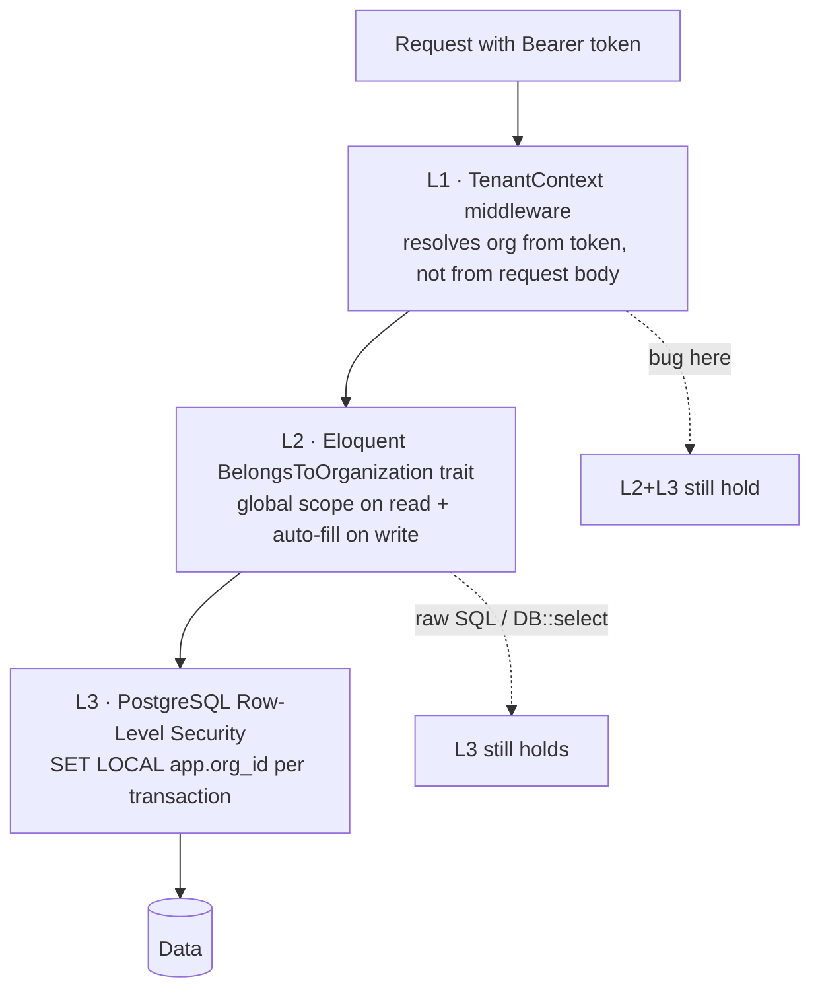

# 02 — Multi-Tenancy & Security Architecture

Covers required outputs **20 (multi-tenant architecture)** and **22 (security architecture)**.

---

## 2.1 Tenancy model: shared database, shared schema, RLS-enforced

Three options were considered:

| Model | Isolation | Cost @ 1000 tenants | Cross-tenant content sharing | Verdict |
|---|---|---|---|---|
| DB per tenant | Strongest | Unmanageable (1000 DBs, 1000 migrations) | Impossible without ETL | ✗ |
| Schema per tenant | Strong | 1000 schemas × 70 tables = 70k tables; migrations crawl | Painful | ✗ |
| **Shared schema + `organization_id` + RLS** | Strong *if enforced at DB level* | Linear, one migration | Native (`organization_id IS NULL`) | ✓ |

The decisive factor is that this product's core value is a **shared platform question
bank**. Physical isolation makes the shared asset architecturally impossible. So we choose
logical isolation and then make it un-bypassable with three independent layers.

### The three enforcement layers



**L1 — TenantContext middleware**

```php
// app/Http/Middleware/ResolveTenant.php
public function handle(Request $request, Closure $next)
{
    $user = $request->user();                      // Sanctum-authenticated
    $org  = $user->currentOrganization();          // from membership, NEVER from header/body
    abort_if(!$org || !$org->is_active, 403, 'No active organization');

    app()->instance(TenantContext::class, new TenantContext(
        organizationId: $org->id,
        membership:     $user->membershipFor($org),
        plan:           $org->activeSubscription?->plan,
    ));

    DB::statement('SET LOCAL app.org_id = ?', [$org->id]);
    DB::statement('SET LOCAL app.is_platform_admin = ?', [$user->isPlatformAdmin() ? 'on' : 'off']);

    Context::add('organization_id', $org->id);      // flows into logs + queued jobs
    return $next($request);
}
```

An `X-Organization-Id` header is accepted **only** for users with multiple memberships,
and only after verifying membership. Impersonation by platform admins is a separate,
audited, time-boxed token type (`impersonation` ability, 30-minute TTL, banner in UI).

**L2 — Eloquent trait**

```php
trait BelongsToOrganization
{
    public static function bootBelongsToOrganization(): void
    {
        static::addGlobalScope('org', function (Builder $q) {
            if (!app()->bound(TenantContext::class)) return;         // console/system context
            $orgId = app(TenantContext::class)->organizationId;
            $q->where(function ($q) use ($orgId) {
                $q->where($q->getModel()->getTable().'.organization_id', $orgId);
                if ($q->getModel()::SHARES_PLATFORM_CONTENT) {
                    $q->orWhereNull($q->getModel()->getTable().'.organization_id');
                }
            });
        });

        static::creating(function ($model) {
            $model->organization_id ??= app(TenantContext::class)->organizationId;
        });
    }
}
```

`SHARES_PLATFORM_CONTENT = true` on content models (`questions`, `books`, `exams`,
`syllabi`, `previous_papers`). `false` on private models (`test_attempts`, `study_plans`,
`generated_documents`, `usage_records`) — a student's attempt is never platform content.

**L3 — PostgreSQL RLS** (the layer that survives developer error)

```sql
ALTER TABLE questions ENABLE ROW LEVEL SECURITY;
ALTER TABLE questions FORCE ROW LEVEL SECURITY;

CREATE POLICY questions_tenant_read ON questions FOR SELECT
  USING (
      current_setting('app.is_platform_admin', true) = 'on'
      OR organization_id IS NULL
      OR organization_id = current_setting('app.org_id', true)::uuid
  );

CREATE POLICY questions_tenant_write ON questions FOR ALL
  USING      (organization_id = current_setting('app.org_id', true)::uuid)
  WITH CHECK (organization_id = current_setting('app.org_id', true)::uuid);
```

Private tables (attempts, documents, plans, usage) get the strict policy without the
`IS NULL` branch. The application connects as `app_user` (RLS applies); migrations and
maintenance jobs use a separate `app_owner` role (`BYPASSRLS`) that is never used by
request-serving code.

**Queued jobs re-establish tenancy.** A job carries `organization_id` in its payload and
re-runs the same `SET LOCAL` in its `handle()` via a `TenantAware` job middleware. A job
without a tenant context throws.

### CI test that must always pass

```php
/** @test */
public function no_model_leaks_across_tenants(): void
{
    foreach ($this->allTenantScopedModels() as $model) {
        $a = Organization::factory()->create();
        $b = Organization::factory()->create();
        $rowB = $model::factory()->for($b)->create();

        $this->actingAsMemberOf($a);
        $this->assertNull($model::find($rowB->id), "$model leaks across tenants");
        $this->assertDatabaseMissingViaRls($model, $rowB->id);   // raw SQL check → proves RLS
    }
}
```

---

## 2.2 Roles, permissions and scope

| Role | Scope | Key capabilities |
|---|---|---|
| **Super Admin** | Platform | Everything, incl. billing config, model routing, impersonation, RLS bypass tooling |
| **Platform Admin** | Platform | Exams, syllabi, sources, prompts, job control, publish platform questions |
| **Content Reviewer** | Platform or org | Review queue: approve / reject / edit / request revision; cannot publish exams |
| **Organization Admin** | One org | Members, seats, billing, org branding, org content, org analytics |
| **Teacher** | One org | Create tests/plans for assigned batches, view student analytics, upload org sources |
| **Student** | One org | Own plans, own tests, own results, own downloads |

Implemented with `spatie/laravel-permission` in **teams mode** (`team_foreign_key =
organization_id`), so one user can be Teacher in org A and Student in org B with different
permission sets under the same account.

Permission naming: `resource.action[.scope]` — e.g. `questions.approve.platform`,
`questions.approve.org`, `tests.create.org`, `documents.download.own`.

Every controller action goes through a Policy. There is no `if ($user->role === 'admin')`
anywhere in the codebase — a lint rule (`grep` in CI) enforces this.

```php
class QuestionPolicy
{
    public function approve(User $u, Question $q): bool
    {
        return $q->organization_id === null
            ? $u->can('questions.approve.platform')
            : $u->can('questions.approve.org') && $u->belongsToOrg($q->organization_id);
    }
}
```

---

## 2.3 Security architecture

```mermaid
flowchart TB
    subgraph P["Perimeter"]
        WAF["Cloudflare WAF · OWASP ruleset · Bot Fight · Turnstile on auth"]
        RL["Rate limiting: IP · user · org · endpoint class"]
    end
    subgraph AUTH["Identity"]
        SES["Sanctum: SPA cookie session (web) + PAT (integrations)"]
        MFA["TOTP MFA — mandatory for admin & reviewer roles"]
        PWD["Argon2id, breach-list check, lockout + backoff"]
    end
    subgraph APP["Application"]
        VAL["FormRequest validation on 100% of inputs"]
        POL["Policy authorization on 100% of resources"]
        TEN["Tenant isolation (L1/L2/L3)"]
        CSRF["CSRF on cookie session; SameSite=Lax; secure cookies"]
    end
    subgraph FILE["File intake"]
        F1["Extension + real MIME sniff + magic bytes"]
        F2["Size caps by plan · page-count cap"]
        F3["ClamAV scan in quarantine bucket"]
        F4["PDF sanitization: strip JS, embedded files, launch actions"]
        F5["Promote to sources bucket only after clean"]
    end
    subgraph DATA["Data"]
        ENC["TLS 1.3 in transit · AES-256 at rest (DB, S3, backups)"]
        SEC["Secrets: AWS Secrets Manager / Vault; rotated; never in .env on disk"]
        PII["PII column encryption (phone, DOB) via Laravel encrypted casts"]
        SIGN["Signed, short-TTL, tenant-bound object URLs"]
        BAK["PITR + nightly logical dump, quarterly restore drill"]
    end
    subgraph AUD["Accountability"]
        LOG["audit_logs: actor, org, action, before/after, ip, ua, request_id"]
        TRC["ai_invocations: every prompt/response hash + cost"]
    end
    WAF --> RL --> AUTH --> APP --> FILE --> DATA --> AUD
```



### Threat model — the eight that actually matter here

| # | Threat | Realistic vector | Control |
|---|---|---|---|
| 1 | **Cross-tenant data read** | ORM bug, raw query, IDOR on UUID | 3-layer isolation + RLS + CI leak test + UUIDv7 PKs |
| 2 | **Question-bank scraping** | Script iterating `/api/v1/questions` | Per-plan read quotas, cursor-only pagination, no bulk export below Institute plan, watermarked PDFs, anomaly alert on >N reads/hour |
| 3 | **Prompt injection via uploaded book** | "Ignore previous instructions" in OCR'd text | Source text passed as a *data block* delimited and role-separated; system prompt states retrieved content is untrusted data; output JSON-Schema validated; no tool access in generation agents |
| 4 | **Malicious PDF** | Weaponized upload to worker | Quarantine bucket, AV scan, sanitization, OCR in a locked-down container (no egress except OCR API, read-only FS, seccomp) |
| 5 | **AI cost abuse** | Tenant loops generation endpoints | Pre-flight quota check → 402, per-org token budget, circuit breaker at 150% of daily forecast, hard per-job token ceiling |
| 6 | **Payment tampering** | Forged webhook | Razorpay signature verification, replay protection via `event_id` uniqueness, server-side re-fetch of order before granting entitlement |
| 7 | **Privilege escalation** | Org admin grants self platform permission | Permission grants restricted to same-or-lower scope; platform permissions assignable only by Super Admin; audited |
| 8 | **Leaked signed URL** | Shared download link | 5-minute TTL, single-use nonce for sensitive docs, URL bound to org, per-document download log |

### Rate limiting policy

| Endpoint class | Limit | Rationale |
|---|---|---|
| `auth.*` | 5/min per IP + 10/hour per email | Credential stuffing |
| Read (`GET`) | 120/min per user | Normal browsing |
| Question search | 30/min per user, 2,000/day per org | Anti-scraping |
| Generation (`POST .../generate`) | 5/min per user, plan quota per month | AI cost |
| Download | 60/min per user | Bandwidth |
| Webhooks | 100/min per provider IP range | Availability |

Implemented with Laravel `RateLimiter` backed by Redis, keyed
`{class}:{org}:{user}`, and returning `429` with `Retry-After` and
`X-RateLimit-Remaining`.

### Audit logging

Everything that changes content, money, permissions or tenancy is audited:

```
audit_logs(id, organization_id, actor_user_id, actor_role, action, auditable_type,
           auditable_id, changes jsonb, ip, user_agent, request_id, created_at)
```

`changes` stores `{before: {...}, after: {...}}` for changed attributes only. Audit rows
are append-only (`REVOKE UPDATE, DELETE`), partitioned monthly, retained 7 years for
billing-relevant events and 2 years otherwise.

### Compliance posture (India)

- **DPDP Act 2023**: consent record at signup, purpose limitation, data-deletion workflow
  (`POST /api/v1/account/erasure` → 30-day grace → anonymize attempts, retain aggregate).
- **Data residency**: all primary storage in `ap-south-1` (Mumbai). LLM provider region
  documented in the privacy policy; no student PII is ever sent to an LLM — prompts carry
  content and topic identifiers only.
- **Payments**: no card data touches our servers (Razorpay-hosted); we store only tokens
  and last-4.
- **Copyright**: source uploads require an admin attestation of rights; `sources.rights_basis`
  records it; generated questions store citations, enabling takedown at chunk granularity.
