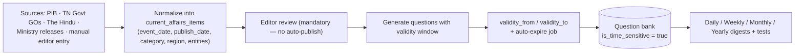

# 04 — Ingestion & OCR Pipeline

Covers required output **5 (OCR pipeline)** and the ingestion half of Engine 1.

---

## 4.1 Full ingestion pipeline

```mermaid
flowchart TB
    U["Admin uploads<br/>'6th Standard TN Science.pdf'"] --> A1

    subgraph INTAKE["Stage A · Intake (synchronous, < 2 s)"]
        A1["Presigned direct-to-R2 upload<br/>(never through the API server)"]
        A2["Extension + magic-byte + MIME sniff"]
        A3["Size cap (plan-based) · page-count cap"]
        A4["SHA-256 content hash → duplicate source check"]
        A5["INSERT sources(status=UPLOADED) + ai_jobs(QUEUED)"]
        A1 --> A2 --> A3 --> A4 --> A5
    end

    A5 --> B1
    subgraph SEC["Stage B · Security (queue: ingest)"]
        B1["ClamAV scan in quarantine bucket"]
        B2["PDF sanitize: strip /JS, /Launch, /EmbeddedFile, /OpenAction"]
        B3["Promote object to sources/ bucket; delete quarantine copy"]
        B1 --> B2 --> B3
    end

    B3 --> C1
    subgraph EXTRACT["Stage C · Text acquisition (queue: ocr)"]
        C1["pdfinfo: pages, producer, encryption"]
        C2{"Digital text layer<br/>≥ 100 chars/page on 80% of pages?"}
        C3["Native extraction (pdftotext -layout / poppler)"]
        C4["Rasterize 300 DPI → deskew → denoise → binarize"]
        C5["OCR: Google Document AI (ta+en)<br/>fallback Tesseract 5 + tam.traineddata"]
        C6["Per-page confidence score"]
        C7{"page confidence < 0.80?"}
        C8["Re-OCR at 400 DPI with alternate engine"]
        C9["Flag page for manual review<br/>(admin OCR correction UI)"]
        C1 --> C2
        C2 -- yes --> C3
        C2 -- no --> C4 --> C5 --> C6 --> C7
        C7 -- yes --> C8 --> C9
        C7 -- no --> D1
        C3 --> D1
    end

    subgraph NORM["Stage D · Normalization (queue: structure)"]
        D1["Unicode NFC normalize · fix Tamil combining marks"]
        D2["De-hyphenate line breaks · join wrapped lines"]
        D3["Strip headers/footers/page numbers (repeat-line detection)"]
        D4["Reading-order reconstruction for 2-column layouts"]
        D5["Detect blocks: heading / prose / table / caption / exercise / callout"]
        D1 --> D2 --> D3 --> D4 --> D5
    end

    D5 --> E1
    subgraph STRUCT["Stage E · Structure detection (queue: structure)"]
        E1["Heuristics pass: TOC parse, numbering patterns,<br/>font-size/bold signals, 'Unit'/'இயல்' keywords"]
        E2["LLM pass (Haiku): confirm/repair chapter→lesson→section tree<br/>input = headings + first line of each block, NOT full text"]
        E3["Write book_chapters, book_lessons, book_sections<br/>with page ranges"]
        E4["Extract book-back exercises → seed_questions(origin=textbook_exercise)"]
        E5["Extract 'important note' callouts → high-value chunk flag"]
        E1 --> E2 --> E3 --> E4 --> E5
    end

    E5 --> F1
    subgraph CHUNK["Stage F · Chunk + embed (queue: embed)"]
        F1["Structure-aware chunker (350–600 tok, 15% overlap,<br/>never crosses lesson boundary)"]
        F2["Attach breadcrumb prefix + metadata + content hash"]
        F3["Dedup by content hash against existing chunks"]
        F4["Batch embed (multilingual-e5-large, 64/batch)"]
        F5["INSERT source_chunks + source_embeddings; build HNSW"]
        F1 --> F2 --> F3 --> F4 --> F5
    end

    F5 --> G1
    subgraph MAP["Stage G · Syllabus mapping (queue: structure)"]
        G1["For each lesson: vector match against exam_topics<br/>of all active syllabus versions"]
        G2["Write book_topic_mappings(confidence)"]
        G3["Emit coverage report: syllabus topics with 0 sources"]
        G1 --> G2 --> G3
    end

    G3 --> H["sources.status = READY<br/>notify admin · unlock 'Generate questions'"]
```



---

## 4.2 OCR engine selection

| Criterion | Google Document AI | Tesseract 5 + `tam` | AWS Textract |
|---|---|---|---|
| Tamil accuracy (printed textbook) | ~97–99% | ~88–93% | Poor for Tamil |
| Layout / reading order | Excellent | Weak | Good |
| Table extraction | Yes | No | Yes |
| Cost per 1000 pages | ~$1.50 | Compute only (~$0.05) | ~$1.50 |
| Ops burden | None | Container + models | None |

**Decision:** Document AI as primary for Tamil and for any scanned page; Tesseract as the
cost-saving fallback for high-quality English scans and as the disaster-recovery path
(no vendor lock-in — `OcrEngine` is an interface with three adapters).

**Never pay to OCR a digital PDF.** The Stage C branch alone cuts OCR spend by ~60% because
most modern state-board PDFs carry a text layer.

### Tamil-specific handling

Tamil OCR fails in specific, correctable ways. Post-OCR we run a rule pass:

| Failure | Correction |
|---|---|
| Split grantha/combining marks (`க` + `ொ` fragments) | Unicode NFC + a curated recomposition map |
| `ஸ்ரீ` / `ஶ்ரீ` variants | Normalize to a canonical form |
| Digit confusion (Tamil numerals vs Latin) | Context rule: inside a number sequence → Latin |
| Zero-width joiner noise | Strip ZWJ/ZWNJ except where lexically required |
| `ஃ` misread as `உ` | Confusion-pair dictionary check against a Tamil lexicon |

A page whose post-correction dictionary hit-rate is < 85% is flagged
`book_pages.needs_review = true` and excluded from chunking until reviewed. Bad OCR
silently poisoning the question bank is the most expensive failure mode in this system, so
we prefer to lose a page than to trust it.

---

## 4.3 Structure detection — heuristics first, LLM second

Sending 200 pages of text to an LLM to "find the chapters" is wasteful and unreliable. The
two-pass approach:

**Pass 1 (free, deterministic).** Extract candidate headings using:
- PDF bookmark/outline tree if present (usually correct — trust it first)
- Numbering regexes: `^(Unit|Chapter|Lesson|இயல்|பாடம்)\s*[-–:]?\s*(\d+|[IVX]+)`
- Typography: font size > 1.3× body median, or bold + short line + followed by paragraph
- Repeated running headers (which give the current chapter on every page)

**Pass 2 (cheap LLM).** Send only the candidate heading list (~2–5 k tokens for a whole
book), plus the first sentence under each, and ask for a corrected tree in JSON:

```json
{
  "chapters": [{
    "number": 2, "title": "The World of Plants", "title_ta": "தாவர உலகம்",
    "start_page": 31, "end_page": 58,
    "lessons": [
      {"number": "2.1", "title": "Parts of a Plant", "start_page": 31, "end_page": 39},
      {"number": "2.2", "title": "Photosynthesis",   "start_page": 40, "end_page": 51}
    ]
  }],
  "exercises_pages": [39, 51, 58],
  "confidence": 0.93
}
```

Cost for a 200-page book: **under ₹3**. Accuracy in testing on TN state-board books: ~95%,
with the remaining 5% corrected in the admin structure editor (a drag-and-drop tree with
page previews — cheaper to build than chasing 100% automation).

---

## 4.4 Chunk record

```json
{
  "id": "018f...",
  "book_id": "018e...",
  "book_lesson_id": "018e...",
  "chunk_index": 87,
  "page_start": 42,
  "page_end": 43,
  "chunk_type": "prose",
  "breadcrumb": "6th Science (EN) › Unit 3 › Lesson 3.2 Circulatory System › pp.42-43",
  "text": "The heart is a muscular organ located slightly to the left of the chest...",
  "token_count": 421,
  "content_hash": "sha256:9f2c...",
  "language_code": "en",
  "importance": 0.78,
  "is_exercise": false,
  "embedding_model": "multilingual-e5-large",
  "created_at": "2026-08-13T09:14:22Z"
}
```

`importance` is computed at index time (not by an LLM) from: presence in a callout box,
appearance in the lesson summary, bold/defined-term density, and whether a book-back
exercise references the same span. It biases retrieval toward what the book itself
signals as examinable.

---

## 4.5 Idempotency & resumability

Ingestion is the longest pipeline in the system (20–60 min for a large book) and *will* be
interrupted. Design rules:

1. Every stage is a separate job with its own row in `ai_jobs` (parent/child).
2. Every stage writes its output before marking itself complete; re-running a completed
   stage is a no-op guarded by `sources.pipeline_state` (a jsonb stage→status map).
3. Chunk insertion is keyed by `(book_id, chunk_index, content_hash)` with an upsert — a
   partial re-run cannot create duplicates.
4. Embeddings are looked up by `content_hash` first: re-ingesting an edited book only
   re-embeds the pages that actually changed.
5. A `RestartFromStage` admin action re-enqueues from any stage without re-uploading.

---

## 4.6 Current-affairs ingestion (separate system)

Current affairs are **not** books and must not be modelled as such (spec §22).



Key differences from textbook content:
- Every item carries `event_date`, `publish_date`, `validity_from`, `validity_to`, `region`
  (TN / India / World) and `category` (15 categories from the spec).
- A nightly job moves expired items to `archived` and removes their questions from active
  test selection (they stay in the bank for "current affairs of 2025" revision papers).
- No AI auto-publish: current affairs errors are reputationally expensive, so a human
  editor approves every item before question generation runs.
- Digests are materialized documents (daily/weekly/monthly/yearly PDFs), generated by a
  scheduled job, not on demand.
