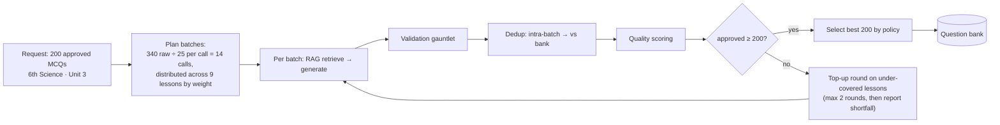
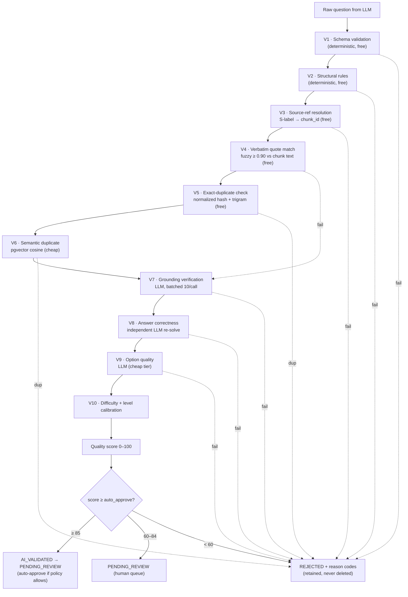
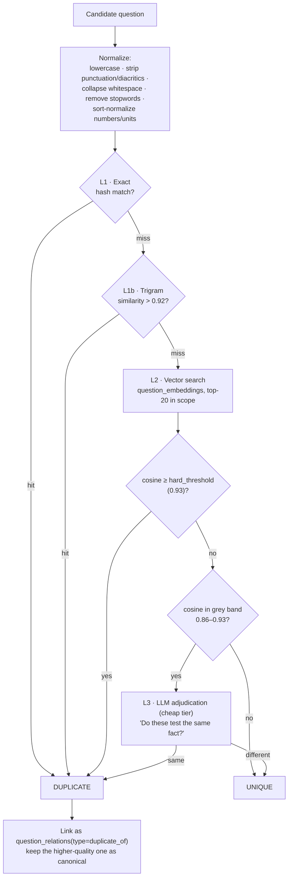
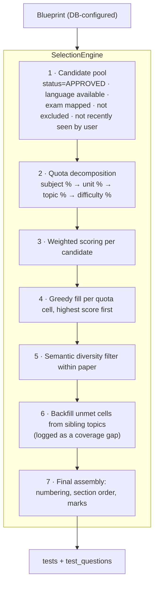

# 05 — Question Generation, Validation, Deduplication & Selection

Covers required outputs **6 (question-generation pipeline)**, **7 (validation pipeline)**,
**8 (duplicate detection)** and the question-selection engine (spec §21).

---

## 5.1 The overgeneration principle

The system is **never** asked for exactly N questions. Asking an LLM for "exactly 200
questions" produces padding, repetition and unsupported claims in the tail.

```
target = 200
raw_target = ceil(target × overgeneration_factor)     // factor default 1.70 → 340
```

`overgeneration_factor` is stored per exam/subject in `generation_policies` and auto-tuned:
a nightly job recomputes it from the observed acceptance rate of the last 30 days per
(subject, difficulty), clamped to [1.4, 2.5]. A topic whose acceptance rate is 55% gets a
factor of 1.85 automatically; a mature topic at 90% drops to 1.45 and saves money.



Batch size is 25 because it is the point where per-call overhead amortizes but the model
still keeps all 25 distinct in working context. Larger batches measurably raise
intra-batch duplication.

---

## 5.2 Generation call

**Inputs assembled per batch**

| Input | Source |
|---|---|
| Retrieved chunks `[S1..S12]` | Hybrid RAG (doc 03) scoped to the target lesson |
| Difficulty mix for this batch | `generation_policies` (e.g. 40/40/20) |
| Exam context | Exam name, level descriptor, typical question style |
| Forbidden overlaps | Stems of questions already accepted for this lesson (compressed to 1 line each, max 40) |
| Blueprint hints | Bloom level targets, question type (MCQ4, assertion-reason, match, statement-based) |
| Language | Master language for this source (EN for English books, TA for Tamil books) |

**Required output schema** (abridged; full schema in doc 09):

```json
{
  "type": "object",
  "required": ["questions"],
  "properties": {
    "questions": {
      "type": "array", "minItems": 1, "maxItems": 30,
      "items": {
        "type": "object", "additionalProperties": false,
        "required": ["question_text","options","correct_option","explanation",
                     "difficulty","bloom_level","topic","source_refs","confidence"],
        "properties": {
          "question_text":  {"type":"string","minLength":15,"maxLength":600},
          "options": {
            "type":"object","additionalProperties":false,
            "required":["A","B","C","D"],
            "properties":{"A":{"type":"string"},"B":{"type":"string"},
                          "C":{"type":"string"},"D":{"type":"string"}}
          },
          "correct_option": {"enum":["A","B","C","D"]},
          "explanation":    {"type":"string","minLength":25,"maxLength":900},
          "difficulty":     {"enum":["easy","medium","hard"]},
          "bloom_level":    {"enum":["remember","understand","apply","analyse"]},
          "topic":          {"type":"string"},
          "subtopic":       {"type":["string","null"]},
          "source_refs":    {"type":"array","minItems":1,"items":{"pattern":"^S[0-9]+$"}},
          "supporting_quote":{"type":"string","minLength":10,"maxLength":300},
          "confidence":     {"type":"number","minimum":0,"maximum":1}
        }
      }
    }
  }
}
```

`supporting_quote` must be a **verbatim span from the cited chunk** — this single field
makes grounding verification a cheap string operation instead of an LLM call for ~70% of
questions.

---

## 5.3 The validation gauntlet

Ten checks, ordered **cheapest-first** so expensive LLM checks only ever see survivors.



### Check definitions

| # | Check | Method | Reject code |
|---|---|---|---|
| V1 | Valid JSON matching schema | JSON Schema validator; one repair retry with the validator error appended | `SCHEMA_INVALID` |
| V2 | Structure: 4 distinct non-empty options; no "all/none of the above" unless policy allows; correct option present; stem not a fragment; no option is a substring duplicate of another; no answer leakage in the stem; option lengths within 3× of each other (length bias) | Deterministic PHP rules | `OPTION_INVALID`, `ANSWER_LEAK`, `STEM_MALFORMED` |
| V3 | Every `source_refs` label maps to a chunk actually sent in this prompt | Map lookup | `SOURCE_UNRESOLVED` |
| V4 | `supporting_quote` appears in the cited chunk (normalized, ≥ 0.90 token-sort ratio) | Fuzzy match | passes to V7 if fail (not an auto-reject — paraphrase is legal) |
| V5 | Exact/near-exact duplicate | `md5(normalize(stem))` + `pg_trgm similarity > 0.92` | `DUPLICATE_EXACT` |
| V6 | Semantic duplicate | Embedding cosine vs bank, threshold from config | `DUPLICATE_SEMANTIC` |
| V7 | Is the claim supported by the cited chunk? | LLM judge, batched 10 per call, sees only the question + cited chunks, returns `{supported: bool, reason}` | `UNSUPPORTED` |
| V8 | Independent solve: a second model, given only the question + options (no answer, no explanation), must pick the same option | LLM; disagreement → escalate to premium tier tie-break | `ANSWER_MISMATCH` |
| V9 | Are all distractors plausible-but-wrong? Any distractor also arguably correct? | LLM cheap tier | `DISTRACTOR_WEAK`, `MULTIPLE_CORRECT` |
| V10 | Difficulty calibration vs a labelled reference set and observed p-values later | Classifier + post-hoc recalibration from real attempt data | (adjusts, never rejects) |

**V8 is the highest-value check in the system.** An independent re-solve catches the
failure that damages trust most: a confidently wrong answer key. Cost is ~₹0.04 per
question at the mid tier — trivially worth it.

### Quality score

```
quality_score =
    22 × grounding_strength        // V4 verbatim + V7 judge confidence
  + 20 × answer_agreement          // V8: 2/2 models agree = 1.0, tie-break = 0.6
  + 15 × option_quality            // V9
  + 12 × distinctiveness           // 1 − max cosine similarity to bank
  + 10 × language_quality          // grammar/register check
  +  8 × difficulty_confidence
  +  8 × exam_alignment            // topic maps to a syllabus node of a target exam
  +  5 × explanation_quality
  → clamp 0..100
```

Thresholds (`generation_policies`, per exam, admin-editable):
`auto_approve ≥ 85` (only for exams flagged `allow_auto_approve`),
`human_review 60–84`, `reject < 60`.

For the MVP, **auto-approve is off**: every question passes a human reviewer. It is turned
on per-subject only after the reviewer override rate for that subject falls below 5% over
500 questions — i.e. we earn automation with measured agreement.

### Rejected questions are retained

`questions.status = REJECTED` with `question_rejections(question_id, code, detail,
stage, actor)`. They are used for: prompt evaluation, factor auto-tuning, reviewer
training, and detecting a bad OCR page (a page producing many `UNSUPPORTED` rejections is
usually a page with broken text — the system raises a source-quality alert).

---

## 5.4 Duplicate-detection architecture



**Scope of comparison** matters as much as the threshold. Comparing a new question against
the whole 500 k bank is slow and wrong (a Tamil-history question is not a duplicate of a
science question). Scope is:

```sql
WHERE (organization_id IS NULL OR organization_id = :org)
  AND subject_id = :subject
  AND (exam_topic_id = :topic OR exam_topic_id IN (:sibling_topics))
  AND status IN ('APPROVED','PENDING_REVIEW','AI_VALIDATED')
```

plus an unscoped pass at a higher threshold (0.96) to catch cross-subject clones.

**Thresholds are configurable per exam** (`similarity_thresholds` table): a UPSC-style
analytical exam tolerates closer stems than a factual Group IV paper.

**The three-tier design is a cost decision.** L1 is free and catches ~35% of duplicates.
L2 costs a vector query (~3 ms) and catches ~60%. Only the ~5% grey band reaches an LLM.

### Cross-paper uniqueness (5 prediction papers)

For the five prediction model papers the requirement is *no duplicates across papers*.
This is enforced at selection time with a running exclusion set:

```php
$used = collect();
foreach ($models as $modelSpec) {
    $paper = $selector->select($modelSpec, excludeIds: $used->pluck('id'),
                               excludeEmbeddings: $used->pluck('embedding'),
                               semanticThreshold: 0.88);
    $used = $used->merge($paper);
}
```

The semantic exclusion (not just ID exclusion) is essential — two *different* questions
about "the year the Indus Valley site of Harappa was excavated" would otherwise both
appear.

---

## 5.5 Question selection engine

Test assembly is a **constrained selection problem**, not `ORDER BY RANDOM()`.



**Candidate score**

```
score = w1·quality_score
      + w2·prediction_score            (0 for plain practice tests)
      + w3·syllabus_weight
      + w4·freshness                   (penalize questions served often platform-wide)
      + w5·personal_gap                (adaptive: user's weak topics)
      - w6·recency_penalty             (seen by this user in last N days)
      - w7·overexposure_penalty        (served > X times this month)
```

Weight vectors are stored per **test type** in `selection_profiles`:

| Test type | quality | prediction | syllabus | freshness | personal gap |
|---|---|---|---|---|---|
| Daily test | 0.40 | 0.05 | 0.20 | 0.15 | 0.20 |
| Weekly test | 0.35 | 0.10 | 0.25 | 0.15 | 0.15 |
| Model test | 0.45 | 0.15 | 0.30 | 0.10 | 0.00 |
| Prediction paper 1 (high-frequency) | 0.30 | **0.50** | 0.10 | 0.10 | 0.00 |
| Prediction paper 4 (full coverage) | 0.35 | 0.10 | **0.45** | 0.10 | 0.00 |

**Blueprints** (`exam_blueprints` + `blueprint_sections`) encode the real exam pattern:

```json
{
  "exam": "TNPSC Group IV", "total_questions": 100, "duration_minutes": 180,
  "marks_per_question": 1.5, "negative_marking": 0.5,
  "difficulty_mix": {"easy": 0.40, "medium": 0.40, "hard": 0.20},
  "sections": [
    {"name": "General Tamil", "questions": 100, "optional_with": "General English"},
    {"name": "General Studies", "questions": 75,
     "topic_weights": {"History": 0.12, "Polity": 0.14, "Geography": 0.12,
                       "Economy": 0.10, "Science": 0.22, "Current Affairs": 0.18,
                       "TN Development": 0.12}},
    {"name": "Aptitude & Mental Ability", "questions": 25}
  ]
}
```

Everything here is data. Adding SSC CGL means inserting a blueprint row — **zero code**.

### Shortfall handling

If a quota cell cannot be filled (e.g. only 4 approved hard Polity questions but 9
needed), the engine does **not** silently substitute. It:
1. Fills from the nearest sibling topic, marking those `test_questions.substituted = true`.
2. Records a `coverage_gaps` row (exam, topic, difficulty, deficit).
3. Surfaces the gap on the admin dashboard as a generation work-item.

This closes the loop: student demand automatically produces the content backlog.
