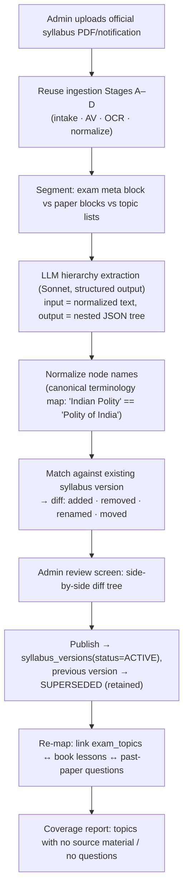
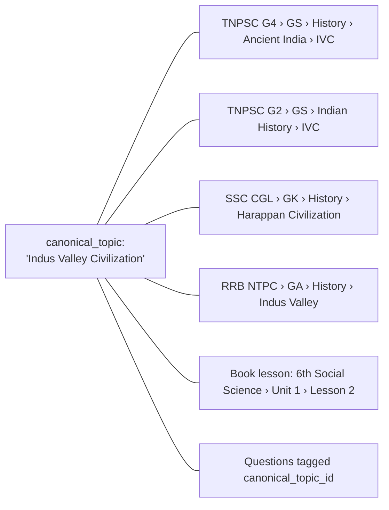
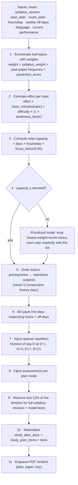
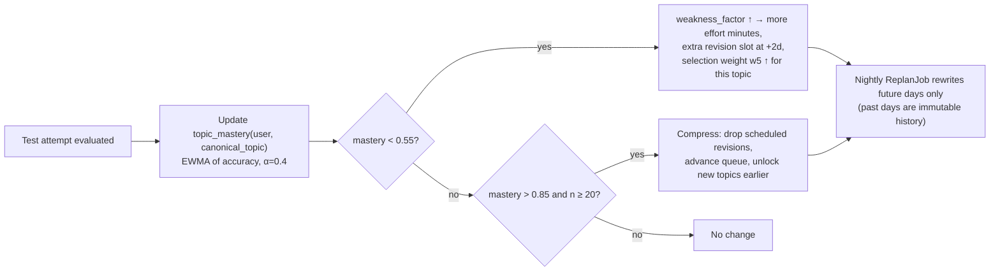
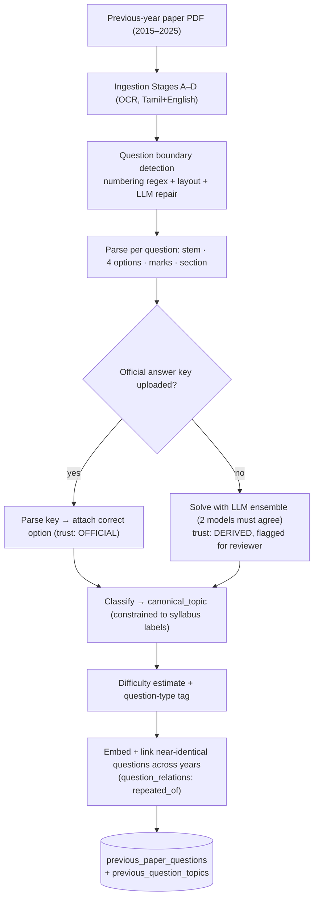

# 06 — Syllabus Analysis, Study Plans & Prediction

Covers required outputs **9 (syllabus-analysis architecture)**, **10 (study-plan
architecture)** and **11 (prediction architecture)** — Engines 2 and 3.

---

## Part A — Engine 2: Syllabus Analysis

### 6.1 Pipeline



### 6.2 Hierarchy model

```
exam (TNPSC Group IV)
└── exam_version (2026 notification)
    └── exam_stage (Prelims / Mains / Interview)      -- multi-stage exams
        └── exam_paper (Paper I, Paper II)
            └── exam_subject (General Studies)
                └── exam_unit (Unit II — Indian History)
                    └── exam_topic (Ancient India)
                        └── exam_topic (Indus Valley Civilization)   -- self-referencing
                            └── exam_topic (Town planning)           -- depth up to 5
```

`exam_topics` is a **self-referencing tree** (`parent_id`, `path` as `ltree`, `depth`,
`display_order`) rather than fixed unit/topic/subtopic tables, because real syllabi vary
in depth. `ltree` gives fast subtree queries:

```sql
SELECT * FROM exam_topics WHERE path <@ 'tnpsc_g4.gs.history.ancient' AND is_leaf;
```

Fixed-name views (`syllabus_units`, `syllabus_topics`) are provided for reporting
compatibility with the spec's table list.

### 6.3 Versioning rules

1. A syllabus version is **immutable** once `ACTIVE`. Corrections create `v2`.
2. `study_plans`, `tests`, and `question_exam_mappings` all reference a
   **`syllabus_version_id`**, never a bare exam id. A student preparing under the 2025
   notification keeps their 2025 plan when the 2026 syllabus lands.
3. Publishing a new version triggers a **migration advisory**, not a forced migration:
   affected students see "Syllabus updated — 3 topics added, 1 removed. Update my plan?"
   with a preview of the diff.
4. `syllabus_version_diffs` stores the machine-readable diff so the advisory, the changelog
   page, and the "what's new" test can all be generated from one source.

### 6.4 Cross-exam topic graph

The same real-world topic appears in many syllabi under different names. A **canonical
topic taxonomy** (`canonical_topics`) sits behind the per-exam trees:



This is the mechanism that makes expansion from "TN exams" to "all India exams" cheap: a
new exam's syllabus is mapped onto existing canonical topics, and it **immediately
inherits the entire question bank** with no generation cost.

---

## Part B — Study Plan Engine

### 6.5 It is a scheduler, not a chatbot

Plan generation is a **deterministic constraint-satisfaction algorithm**. This is a
deliberate architectural choice:

| Property | Deterministic scheduler | LLM-generated plan |
|---|---|---|
| Cost per plan | ₹0 | ₹4–12 |
| Reproducible | Yes | No |
| Respects exact hours/day arithmetic | Yes | Frequently wrong |
| Guarantees full syllabus coverage | Provable | Hope |
| Adapts to performance data | Trivially | Requires re-prompting with data |

The LLM contributes exactly one optional thing: a short motivational/technique note per
day, generated once per (syllabus_version, plan_shape, day_type) and **shared across all
users** — so its cost is amortized to effectively zero.

### 6.6 Scheduling algorithm



Spaced repetition uses a fixed SM-2-derived interval ladder (1, 3, 7, 21 days) rather than
per-item scheduling, because plans must be printable and predictable.

### 6.7 The five plan modes

Each mode is a **`plan_blueprint`** row — same engine, different parameters. Each gets its
own page in the app (spec §7, §8, §30).

| Mode | Horizon | Structure | Assessments | Documents produced |
|---|---|---|---|---|
| **Daily** | 1 day (rolling, regenerated nightly) | 2–4 topics, sized to hours | 1 daily test (20 Q) | Daily Plan PDF · Daily Question Paper PDF · Daily Answer Key PDF |
| **3-Day** | 3 days | D1 new · D2 new + revise D1 · D3 revise + test | 1 cycle test (50 Q) | 3-Day Plan PDF · 3-Day Paper PDF · 3-Day Key PDF |
| **Weekly** | 7 days | Mon–Sat topics, Sun revision + test | Daily 15 Q + weekly 75 Q | Weekly Plan PDF · Weekly Paper PDF · Weekly Key PDF (+ 7 daily sets) |
| **Monthly** | 4–5 weeks | Week 1–4 topic blocks, week 5 revision | Weekly tests + monthly 100 Q | Monthly Plan PDF · Monthly Paper PDF · Monthly Key PDF |
| **Model Test** | Point-in-time | Full blueprint simulation | Full-length exam-pattern paper | Model Paper PDF · Answer Key PDF · Explanation PDF |

All five are generated from the same `study_plans` table with `mode` + `blueprint_id`.
A student may run several concurrently (a monthly macro-plan plus the daily micro-plan
derived from it) — `study_plans.parent_plan_id` links them so the daily plan inherits the
monthly plan's topic queue instead of contradicting it.

### 6.8 Adaptive re-planning (spec §32)



**Past days are never rewritten** — a plan the student already followed is a record, not a
projection. Only `plan_date > today` is regenerated, and every regeneration is versioned
(`study_plans.revision`, with a diff shown to the user).

---

## Part C — Engine 3: Previous-Paper Analysis & Prediction

### 6.9 Extraction pipeline



Two properties are essential:
- Classification is **constrained** to the syllabus node list (the model picks from an
  enumerated set, it does not free-text a topic name) — otherwise frequency analysis is
  meaningless because the same topic gets 20 spellings.
- Repeats across years are linked, so "this exact question appeared in 2017 and 2021" is a
  first-class fact, and the single most persuasive thing you can show a student.

### 6.10 Prediction scoring model

Explicitly **statistical and explainable**, not an LLM guess.

For each `(canonical_topic, exam)`:

```
frequency        = Σ over years w_recency(y) × questions_from_topic(y) / total_questions(y)
w_recency(y)     = exp(-λ × (current_year − y)),  λ = 0.25   → 2024 ≈ 0.78, 2015 ≈ 0.08
trend            = OLS slope of yearly share over last 6 years, normalized to [-1, 1]
syllabus_weight  = explicit blueprint weight of the topic (0–1)
cyclicity        = 1 if topic appears on a detected k-year cycle and next year is due
gap_pressure     = years_since_last_appearance / mean_gap   (capped at 2.0)
current_affairs  = linkage score to active CA items (topics tied to recent events)
coverage_norm    = correction for uneven paper counts per year

prediction_raw =
      0.34 × frequency
    + 0.18 × normalize(trend)
    + 0.22 × syllabus_weight
    + 0.10 × gap_pressure
    + 0.08 × cyclicity
    + 0.08 × current_affairs_link

prediction_score = round(100 × calibrate(prediction_raw))        -- isotonic calibration
```

**Bands** (spec §9): 90–100 Very High · 75–89 High · 60–74 Medium · 40–59 Low · 0–39 Very Low.

### 6.11 Calibration and honesty

`calibrate()` is fitted by back-testing: train on years ≤ Y−1, predict year Y, compare
predicted topic share to actual. This yields a real, publishable metric —
**"topics we scored Very High supplied 71% of the 2025 paper"** — and it is the honest
claim the marketing may make.

Hard product rules:
- The UI never says "these questions will come".
- Every prediction surface carries: *"Probabilistic estimate from historical patterns.
  Not a guarantee. Full-syllabus preparation is still required."*
- Each score exposes its **contribution breakdown** (frequency 34, syllabus 22, trend 12…)
  so a student and a teacher can see why.
- Back-test accuracy is shown alongside the score, updated annually.

### 6.12 The five prediction papers

| Paper | Selection profile | Intent |
|---|---|---|
| **Model 1 — High-frequency** | Top-quartile prediction_score topics only; difficulty per blueprint | "If you only had 3 days" |
| **Model 2 — Balanced** | Topic distribution proportional to blueprint weights, prediction as tiebreak | Realistic full-pattern paper |
| **Model 3 — Historical pattern** | Mirrors the *question-type and topic sequence* of the last 3 real papers | Trains exam-day pattern recognition |
| **Model 4 — Full coverage** | Maximum distinct-topic coverage; ≥ 1 question from every unit | Finds blind spots |
| **Model 5 — Combined advanced** | Ensemble: 40% M1 profile + 30% M2 + 20% hard-difficulty skew + 10% recent CA | Final-week stress test |

Generated as a single job that builds all five with a shared semantic exclusion set
(doc 05 §5.4) so no question — and no near-duplicate — repeats across the set. Ten PDFs
(5 papers + 5 keys) plus the **Important / Repeated Topic Analysis PDF**:

| Column | Source |
|---|---|
| Topic | `canonical_topics.name` (+ localized name) |
| Frequency | Weighted count of appearances |
| Years appeared | `2016, 2018, 2019, 2022, 2024` |
| Syllabus importance | Blueprint weight |
| Question pattern | Modal question type + example stems |
| Prediction score + band | §6.10 |
| Priority | `HIGH / MEDIUM / LOW` from score × your personal mastery gap |
| Where to study | Book, chapter, page range (from `book_topic_mappings`) |

That last column is the differentiator: the report is not just analysis, it is a directed
reading list linked back to the exact source pages.
