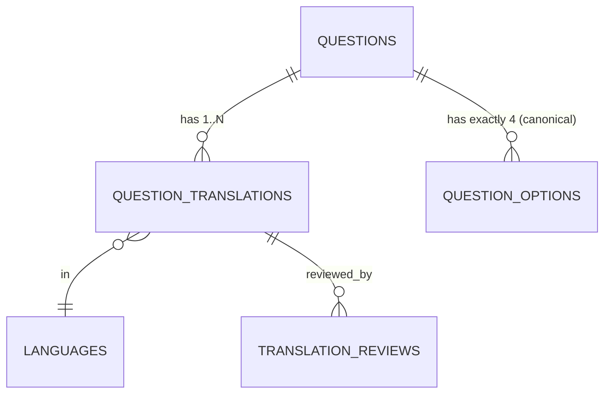
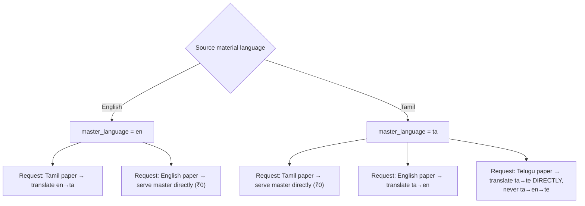
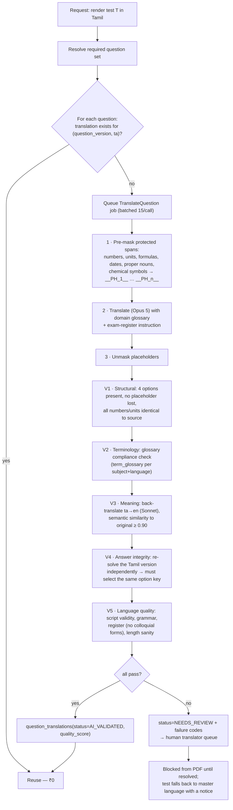
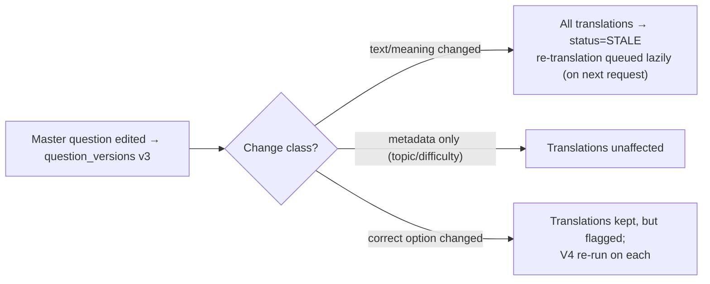
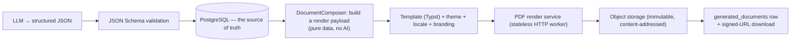
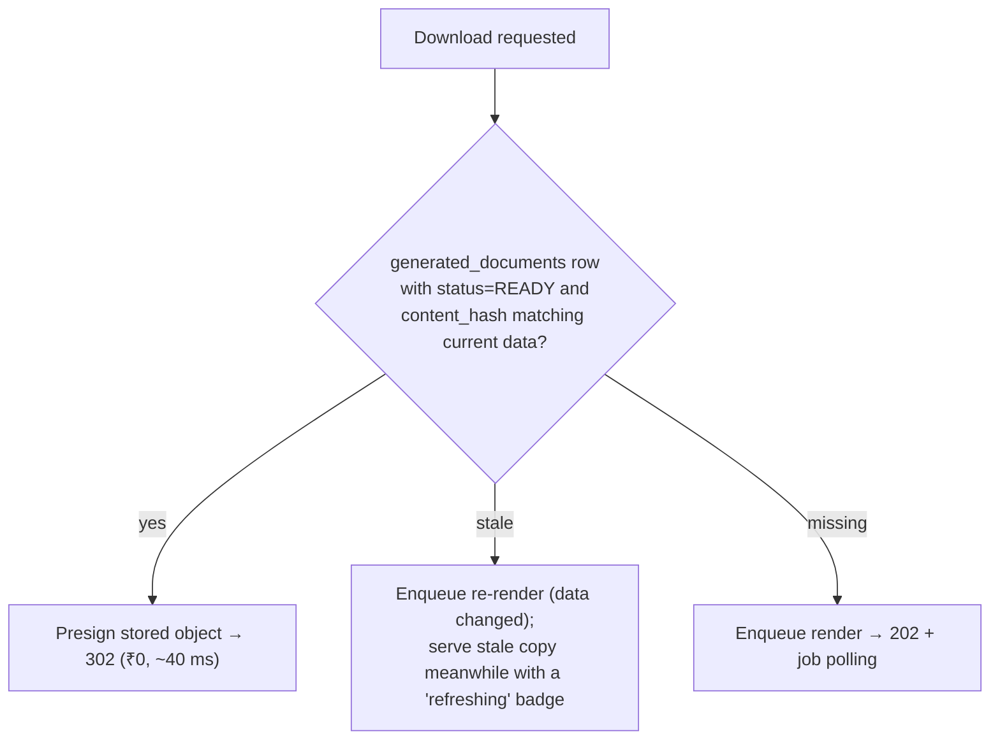

# 07 — Multilingual Engine & PDF Generation

Covers required outputs **12 (multilingual architecture)** and **13 (PDF-generation
architecture)** — Engine 4.

---

## Part A — Multilingual Architecture

### 7.1 Model: one logical question, N language projections



- `questions` holds **language-neutral truth**: which option is correct, difficulty, topic,
  citations, quality, prediction linkage.
- `question_translations` holds the **rendering** in one language, including the master
  language (`is_master = true`). There is no "the English text lives in `questions` and
  other languages live elsewhere" asymmetry — that asymmetry always rots.
- `question_options` holds the canonical option keys `A/B/C/D`, their order and
  `is_correct`. A translation may not change the number, order, or correctness of options —
  enforced by a DB constraint plus a validator.

**Correct answer is stored once, on the question.** No translation can ever disagree with
the answer key. This eliminates the classic bug where a Tamil paper's key differs from the
English one.

### 7.2 Master-language rule



Pivoting through English destroys Tamil literary and technical register and compounds
error. The `TranslationRouter` always translates **source-master → target** directly, and
records `source_language_id` on every translation row so provenance is auditable.

Per-question `master_language_id` (not per-platform) is what makes this work: a Tamil
literature question is mastered in Tamil; a physics question from an English textbook is
mastered in English. Both coexist in one bank.

### 7.3 Translation pipeline



**V4 is the critical check.** Translating a question is not a text task — it is a task with
a *verifiable invariant*: the translated question must still have exactly the same correct
answer. Re-solving the Tamil rendering with a model that never sees the answer key catches
the meaning-drift that back-translation similarity misses.

### 7.4 Protected-span masking (why translations stay correct)

| Category | Example | Handling |
|---|---|---|
| Numbers | `1,26,000` | Masked; Indian digit grouping preserved; optional Tamil numeral rendering flag |
| Units | `km/h`, `mol`, `°C` | Masked; unit glossary maps to accepted localized form or keeps Latin |
| Formulae | `6CO₂ + 6H₂O → C₆H₁₂O₆` | Masked entirely, never translated |
| Dates/years | `1947`, `21 June` | Masked; month names translated via glossary |
| Proper nouns | `Bhagat Singh`, `Cauvery` | Transliterated via a curated name map, not free translation |
| Technical terms | `photosynthesis` → `ஒளிச்சேர்க்கை` | Forced from `term_glossary` (exam-board approved terms) |
| Option labels | `A/B/C/D` | Never localized in storage; localized only at render time if required |

The glossary is a first-class, admin-editable table (`term_glossary`) with entries sourced
from official Tamil Nadu textbook terminology — because state-board exams expect the
board's exact terms, not a fluent alternative.

### 7.5 Versioning & invalidation

`question_translations.source_question_version` pins the master version it was translated
from. When a reviewer edits the master question:



**Lazy re-translation** is deliberate: a stale Telugu translation of a question nobody has
requested in Telugu for 6 months should not cost money to refresh. It refreshes on first
demand.

### 7.6 Language rollout

Phase 5 order: **Tamil** (MVP, with English) → Telugu → Malayalam → Hindi → Kannada →
Marathi, Bengali, Gujarati, Odia, Punjabi, Urdu.

Adding a language requires, in order: (1) a `languages` row, (2) a font bundle in the PDF
service, (3) a `term_glossary` seed for the top ~2,000 exam terms, (4) a
`translation_{lang}_v1` prompt version passing the evaluation gate, (5) a native reviewer
for the first 500 questions. No code changes.

---

## Part B — PDF Generation Architecture

### 7.7 The LLM never produces a PDF



Reasons this indirection is non-negotiable: pagination and numbering must be exact; the
same test must produce a byte-identical PDF on re-render; Indic shaping must be handled by
a text engine, not a language model; and a PDF must be re-renderable years later from
stored data when the model that wrote the questions no longer exists.

### 7.8 Renderer choice

| Option | Indic shaping | Speed | Determinism | Ops |
|---|---|---|---|---|
| **Typst** (chosen) | Excellent (HarfBuzz) | ~120 ms/paper | High | Single binary in a worker |
| LaTeX/XeLaTeX | Excellent | ~2–5 s | High | Heavy toolchain |
| Headless Chrome (Gotenberg) | Good | ~800 ms | Medium (font/version drift) | Browser fleet |
| DomPDF/mPDF | Poor for Tamil | Fast | High | ✗ — fails ligatures |

Typst primary; Gotenberg retained as a fallback adapter for complex HTML-based reports
(analytics dashboards exported to PDF).

**Fonts** (bundled, licence-cleared, subset per document):
Noto Sans/Serif Tamil · Telugu · Malayalam · Devanagari · Kannada · Bengali · Gujarati ·
Oriya · Gurmukhi · Nastaliq (Urdu) · Latin. Subsetting keeps a 100-question Tamil paper
under ~300 KB.

### 7.9 Document types & templates

| Document | Template | Contents |
|---|---|---|
| Question Paper | `question_paper` | Cover (exam, subject, duration, marks, instructions), sections, numbered questions, 4 options, OMR-friendly layout, page numbers, watermark |
| Answer Key | `answer_key` | Compact answer grid + per-question correct option + topic + difficulty |
| Explanation Paper | `explanations` | Question + answer + explanation + **source citation (book, chapter, page)** |
| Study Plan | `study_plan_{mode}` | Calendar table, topics, target hours, reading references, checkboxes, revision markers |
| Prediction Analysis | `prediction_report` | Topic table, score bands, year charts, priority, disclaimer |
| Topic Analysis | `topic_analysis` | Repeated-topic report (doc 06 §6.12) |
| Result Report | `result_report` | Score, accuracy, topic breakdown, weak areas, next actions |
| CA Digest | `ca_digest` | Daily/weekly/monthly current-affairs digest + questions |

Templates are versioned (`document_templates`) so a re-render years later reproduces the
original layout, and branding is injected per tenant (`organizations.branding`: logo,
colours, header/footer text, watermark).

### 7.10 Render payload

```json
{
  "template": "question_paper", "template_version": 3, "locale": "ta",
  "branding": {"org_name":"Anna Academy","logo_url":"...","primary_color":"#0F5132",
               "watermark":"ANNA ACADEMY — 9876543210"},
  "meta": {"title":"TNPSC Group IV — Weekly Test 7","subject":"General Studies",
           "duration_minutes":90,"total_marks":75,"total_questions":50,
           "instructions_key":"tnpsc_g4_standard","date":"2026-08-20",
           "document_code":"WT-7-TA-018f3c"},
  "sections":[{
    "title":"பொது அறிவு",
    "questions":[{
      "number":1,
      "text":"மனித உடலில் இரத்தத்தை உந்தித் தள்ளும் உறுப்பு எது?",
      "options":[{"key":"A","text":"நுரையீரல்"},{"key":"B","text":"இதயம்"},
                 {"key":"C","text":"சிறுநீரகம்"},{"key":"D","text":"கல்லீரல்"}],
      "marks":1.5
    }]
  }],
  "footer": {"page_numbering":"n_of_m","copyright":"© ExamForge 2026"}
}
```

The **answer key is a separate render from the same payload id** — never a second AI call,
never a second data source. Both documents carry the same `document_code`, so a student
can always match a key to its paper.

### 7.11 Materialization, reuse and regeneration



`content_hash = sha256(template_version + locale + branding_version + ordered question
version ids)`. This makes "has anything actually changed?" a free comparison, and makes
identical requests from 10,000 students resolve to **one stored object**.

Explicit **Regenerate** (a user action in the spec's VIEW/PREVIEW/DOWNLOAD/REGENERATE/SHARE
set) creates a *new* document row with a new question selection — it never mutates the old
one, so a teacher who already distributed a paper keeps their copy valid.

**Share** produces a signed, expiring, optionally password-protected public link
(`document_shares`), with per-link download counting and revocation — teachers share papers
with batches, and that must be tracked, not open-ended.
