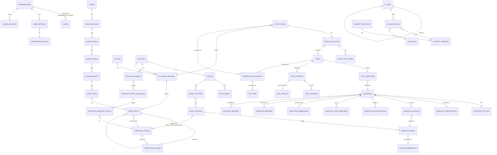

# 08 — PostgreSQL Schema & ER Model

Covers required outputs **14 (ER diagram)** and **15 (complete database schema)**.
Nothing here is optional: every relationship in the spec is modelled explicitly.

---

## 8.0 Conventions

| Convention | Rule |
|---|---|
| Primary keys | `UUID v7` (`uuid_generate_v7()`) — time-sortable, non-enumerable, safe in URLs |
| Tenancy | `organization_id UUID NULL` on every tenant-aware table; `NULL` = platform-owned |
| Timestamps | `created_at`, `updated_at` `timestamptz` (UTC); `deleted_at` for soft deletes where audit requires it |
| Enums | PostgreSQL `ENUM` types for closed sets; lookup tables where admins must extend them |
| Money | `numeric(12,4)` in INR; never floats |
| Vectors | `vector(1024)` (multilingual-e5-large); model recorded per row |
| JSON | `jsonb` only, with CHECK constraints or schema validation at write time |
| Naming | plural snake_case tables, singular FK `<table_singular>_id` |
| Partitioning | monthly `RANGE` on high-volume append-only tables |

Extensions: `pgcrypto`, `vector`, `pg_trgm`, `btree_gin`, `ltree`, `pg_stat_statements`.

---

## 8.1 Master ER overview



---

## 8.2 Domain 1 — Identity, tenancy, billing

```sql
CREATE TYPE org_type AS ENUM ('individual','coaching_institute','school','enterprise','platform');

CREATE TABLE organizations (
    id                 uuid PRIMARY KEY DEFAULT uuid_generate_v7(),
    name               text NOT NULL,
    slug               citext UNIQUE NOT NULL,
    type               org_type NOT NULL DEFAULT 'individual',
    owner_user_id      uuid,                                   -- FK added after users
    branding           jsonb NOT NULL DEFAULT '{}',            -- logo_url, colors, watermark
    settings           jsonb NOT NULL DEFAULT '{}',            -- default lang, exam, thresholds
    seat_limit         int,
    is_active          boolean NOT NULL DEFAULT true,
    trial_ends_at      timestamptz,
    created_at         timestamptz NOT NULL DEFAULT now(),
    updated_at         timestamptz NOT NULL DEFAULT now(),
    deleted_at         timestamptz
);

CREATE TABLE users (
    id                    uuid PRIMARY KEY DEFAULT uuid_generate_v7(),
    email                 citext UNIQUE NOT NULL,
    phone                 text,                                -- encrypted at app layer
    name                  text NOT NULL,
    password_hash         text,                                -- null for OAuth-only
    email_verified_at     timestamptz,
    phone_verified_at     timestamptz,
    mfa_secret            text,                                -- encrypted
    mfa_enabled_at        timestamptz,
    locale                text NOT NULL DEFAULT 'en',
    preferred_language_id uuid REFERENCES languages(id),
    timezone              text NOT NULL DEFAULT 'Asia/Kolkata',
    is_platform_admin     boolean NOT NULL DEFAULT false,
    last_login_at         timestamptz,
    created_at            timestamptz NOT NULL DEFAULT now(),
    updated_at            timestamptz NOT NULL DEFAULT now(),
    deleted_at            timestamptz
);

CREATE TABLE organization_users (             -- membership + role scoping
    id               uuid PRIMARY KEY DEFAULT uuid_generate_v7(),
    organization_id  uuid NOT NULL REFERENCES organizations(id) ON DELETE CASCADE,
    user_id          uuid NOT NULL REFERENCES users(id) ON DELETE CASCADE,
    status           text NOT NULL DEFAULT 'active',   -- active|invited|suspended
    joined_at        timestamptz NOT NULL DEFAULT now(),
    UNIQUE (organization_id, user_id)
);

-- spatie/laravel-permission in TEAMS mode (team key = organization_id)
CREATE TABLE roles       (id bigserial PRIMARY KEY, name text, guard_name text,
                          organization_id uuid, UNIQUE (name, guard_name, organization_id));
CREATE TABLE permissions (id bigserial PRIMARY KEY, name text UNIQUE, guard_name text);
CREATE TABLE role_has_permissions (permission_id bigint REFERENCES permissions(id),
                                   role_id bigint REFERENCES roles(id),
                                   PRIMARY KEY (permission_id, role_id));
CREATE TABLE model_has_roles (role_id bigint REFERENCES roles(id), model_type text,
                              model_id uuid, organization_id uuid,
                              PRIMARY KEY (role_id, model_id, model_type, organization_id));

CREATE TABLE subscription_plans (
    id                  uuid PRIMARY KEY DEFAULT uuid_generate_v7(),
    code                text UNIQUE NOT NULL,        -- free|basic|pro|premium|institute
    name                text NOT NULL,
    description         text,
    price_inr_monthly   numeric(12,2) NOT NULL DEFAULT 0,
    price_inr_yearly    numeric(12,2),
    currency            char(3) NOT NULL DEFAULT 'INR',
    billing_provider_id text,                        -- razorpay plan id
    features            jsonb NOT NULL DEFAULT '{}', -- booleans: prediction, institute_dash…
    is_public           boolean NOT NULL DEFAULT true,
    sort_order          int NOT NULL DEFAULT 0,
    created_at          timestamptz NOT NULL DEFAULT now(),
    updated_at          timestamptz NOT NULL DEFAULT now()
);

CREATE TABLE plan_quotas (                       -- limits are DATA, never constants
    id                uuid PRIMARY KEY DEFAULT uuid_generate_v7(),
    plan_id           uuid NOT NULL REFERENCES subscription_plans(id) ON DELETE CASCADE,
    metric            text NOT NULL,             -- questions_generated | pdf_generated |
                                                 -- ai_tokens | model_tests | languages |
                                                 -- storage_bytes | exams | seats | plans
    period            text NOT NULL DEFAULT 'month',   -- day|month|year|lifetime
    limit_value       bigint NOT NULL,           -- -1 = unlimited
    overage_allowed   boolean NOT NULL DEFAULT false,
    overage_price_inr numeric(12,4),
    UNIQUE (plan_id, metric, period)
);

CREATE TABLE subscriptions (
    id                    uuid PRIMARY KEY DEFAULT uuid_generate_v7(),
    organization_id       uuid NOT NULL REFERENCES organizations(id) ON DELETE CASCADE,
    plan_id               uuid NOT NULL REFERENCES subscription_plans(id),
    status                text NOT NULL,   -- trialing|active|past_due|cancelled|expired
    provider              text NOT NULL DEFAULT 'razorpay',
    provider_subscription_id text,
    seats                 int NOT NULL DEFAULT 1,
    current_period_start  timestamptz NOT NULL,
    current_period_end    timestamptz NOT NULL,
    cancel_at_period_end  boolean NOT NULL DEFAULT false,
    cancelled_at          timestamptz,
    created_at            timestamptz NOT NULL DEFAULT now(),
    updated_at            timestamptz NOT NULL DEFAULT now()
);
CREATE UNIQUE INDEX one_active_sub_per_org ON subscriptions (organization_id)
    WHERE status IN ('trialing','active','past_due');

CREATE TABLE payments (
    id                  uuid PRIMARY KEY DEFAULT uuid_generate_v7(),
    organization_id     uuid NOT NULL REFERENCES organizations(id),
    subscription_id     uuid REFERENCES subscriptions(id),
    provider            text NOT NULL,
    provider_payment_id text UNIQUE,
    provider_order_id   text,
    amount_inr          numeric(12,2) NOT NULL,
    tax_inr             numeric(12,2) NOT NULL DEFAULT 0,
    status              text NOT NULL,          -- created|authorized|captured|failed|refunded
    method              text,                   -- upi|card|netbanking
    invoice_number      text UNIQUE,
    invoice_url         text,
    raw_payload         jsonb,
    paid_at             timestamptz,
    created_at          timestamptz NOT NULL DEFAULT now()
);

CREATE TABLE usage_records (                    -- metering, partitioned monthly
    id               uuid DEFAULT uuid_generate_v7(),
    organization_id  uuid NOT NULL,
    user_id          uuid,
    metric           text NOT NULL,
    quantity         bigint NOT NULL,
    cost_inr         numeric(12,4) NOT NULL DEFAULT 0,
    ai_job_id        uuid,
    reference_type   text,
    reference_id     uuid,
    occurred_at      timestamptz NOT NULL DEFAULT now(),
    PRIMARY KEY (id, occurred_at)
) PARTITION BY RANGE (occurred_at);

CREATE INDEX usage_org_metric_time ON usage_records (organization_id, metric, occurred_at DESC);
```

---

## 8.3 Domain 2 — Exams, syllabi, taxonomy

```sql
CREATE TABLE languages (
    id            uuid PRIMARY KEY DEFAULT uuid_generate_v7(),
    code          text UNIQUE NOT NULL,        -- ISO 639-1: en, ta, te, ml, hi, kn…
    name          text NOT NULL,
    native_name   text NOT NULL,
    script        text NOT NULL,               -- Latn, Taml, Telu, Deva…
    direction     char(3) NOT NULL DEFAULT 'ltr',
    font_family   text NOT NULL,               -- for the PDF renderer
    is_active     boolean NOT NULL DEFAULT false,
    sort_order    int NOT NULL DEFAULT 0
);

CREATE TABLE exams (
    id                 uuid PRIMARY KEY DEFAULT uuid_generate_v7(),
    organization_id    uuid REFERENCES organizations(id),     -- NULL = platform exam
    code               text NOT NULL,                          -- TNPSC_G4
    name               text NOT NULL,
    conducting_body    text,                                   -- TNPSC, SSC, RRB
    country            char(2) NOT NULL DEFAULT 'IN',
    state              text,                                   -- 'TN' or NULL for national
    category           text,                                   -- state_govt|central_govt|banking|private
    level              text,                                   -- 10th|12th|graduate
    description        text,
    is_active          boolean NOT NULL DEFAULT true,
    created_at         timestamptz NOT NULL DEFAULT now(),
    UNIQUE (organization_id, code)
);

CREATE TABLE exam_versions (               -- the 2025 notification vs the 2026 notification
    id             uuid PRIMARY KEY DEFAULT uuid_generate_v7(),
    exam_id        uuid NOT NULL REFERENCES exams(id) ON DELETE CASCADE,
    version_label  text NOT NULL,          -- '2026'
    notification_date date,
    exam_date      date,
    status         text NOT NULL DEFAULT 'draft',  -- draft|active|superseded|archived
    source_id      uuid REFERENCES sources(id),    -- the notification PDF
    created_at     timestamptz NOT NULL DEFAULT now(),
    UNIQUE (exam_id, version_label)
);

CREATE TABLE exam_stages (                 -- Prelims / Mains / Interview / Physical
    id              uuid PRIMARY KEY DEFAULT uuid_generate_v7(),
    exam_version_id uuid NOT NULL REFERENCES exam_versions(id) ON DELETE CASCADE,
    name            text NOT NULL,
    sequence        int NOT NULL,
    is_qualifying   boolean NOT NULL DEFAULT false,
    UNIQUE (exam_version_id, sequence)
);

CREATE TABLE exam_papers (
    id              uuid PRIMARY KEY DEFAULT uuid_generate_v7(),
    exam_stage_id   uuid NOT NULL REFERENCES exam_stages(id) ON DELETE CASCADE,
    name            text NOT NULL,                 -- 'Paper I'
    sequence        int NOT NULL,
    duration_minutes int,
    total_questions int,
    total_marks     numeric(8,2),
    negative_marking numeric(4,2) NOT NULL DEFAULT 0,
    question_type   text NOT NULL DEFAULT 'mcq4',  -- mcq4|mcq5|descriptive|mixed
    UNIQUE (exam_stage_id, sequence)
);

CREATE TABLE exam_subjects (
    id            uuid PRIMARY KEY DEFAULT uuid_generate_v7(),
    exam_paper_id uuid NOT NULL REFERENCES exam_papers(id) ON DELETE CASCADE,
    name          text NOT NULL,                   -- 'General Studies'
    code          text,
    weight        numeric(5,4) NOT NULL DEFAULT 0, -- share of the paper
    question_count int,
    is_optional   boolean NOT NULL DEFAULT false,
    optional_group text,                            -- 'language_choice'
    sequence      int NOT NULL DEFAULT 0
);

CREATE TABLE exam_languages (                       -- which languages an exam is offered in
    exam_version_id uuid REFERENCES exam_versions(id) ON DELETE CASCADE,
    language_id     uuid REFERENCES languages(id),
    is_default      boolean NOT NULL DEFAULT false,
    PRIMARY KEY (exam_version_id, language_id)
);

CREATE TABLE syllabi (
    id           uuid PRIMARY KEY DEFAULT uuid_generate_v7(),
    exam_id      uuid NOT NULL REFERENCES exams(id) ON DELETE CASCADE,
    name         text NOT NULL,
    created_at   timestamptz NOT NULL DEFAULT now()
);

CREATE TABLE syllabus_versions (
    id                uuid PRIMARY KEY DEFAULT uuid_generate_v7(),
    syllabus_id       uuid NOT NULL REFERENCES syllabi(id) ON DELETE CASCADE,
    exam_version_id   uuid NOT NULL REFERENCES exam_versions(id),
    version_number    int NOT NULL,
    effective_from    date NOT NULL,
    effective_to      date,
    status            text NOT NULL DEFAULT 'draft',  -- draft|active|superseded|archived
    source_id         uuid REFERENCES sources(id),
    extraction_job_id uuid,
    published_by      uuid REFERENCES users(id),
    published_at      timestamptz,
    created_at        timestamptz NOT NULL DEFAULT now(),
    UNIQUE (syllabus_id, version_number)
);
CREATE UNIQUE INDEX one_active_syllabus_version
  ON syllabus_versions (syllabus_id) WHERE status = 'active';

CREATE TABLE canonical_topics (            -- cross-exam normalized taxonomy
    id             uuid PRIMARY KEY DEFAULT uuid_generate_v7(),
    parent_id      uuid REFERENCES canonical_topics(id),
    slug           text UNIQUE NOT NULL,   -- indus-valley-civilization
    name           text NOT NULL,
    domain         text NOT NULL,          -- history|polity|science|aptitude|current_affairs
    path           ltree NOT NULL,
    depth          int NOT NULL,
    aliases        text[] NOT NULL DEFAULT '{}',
    created_at     timestamptz NOT NULL DEFAULT now()
);
CREATE INDEX canonical_topics_path_gist ON canonical_topics USING gist (path);

CREATE TABLE exam_units (
    id                  uuid PRIMARY KEY DEFAULT uuid_generate_v7(),
    syllabus_version_id uuid NOT NULL REFERENCES syllabus_versions(id) ON DELETE CASCADE,
    exam_subject_id     uuid NOT NULL REFERENCES exam_subjects(id) ON DELETE CASCADE,
    code                text,                   -- 'Unit II'
    name                text NOT NULL,
    weight              numeric(5,4) NOT NULL DEFAULT 0,
    sequence            int NOT NULL DEFAULT 0
);

CREATE TABLE exam_topics (                      -- self-referencing tree, any depth
    id                  uuid PRIMARY KEY DEFAULT uuid_generate_v7(),
    syllabus_version_id uuid NOT NULL REFERENCES syllabus_versions(id) ON DELETE CASCADE,
    exam_unit_id        uuid NOT NULL REFERENCES exam_units(id) ON DELETE CASCADE,
    parent_id           uuid REFERENCES exam_topics(id) ON DELETE CASCADE,
    canonical_topic_id  uuid REFERENCES canonical_topics(id),
    name                text NOT NULL,
    path                ltree NOT NULL,
    depth               int NOT NULL DEFAULT 1,
    is_leaf             boolean NOT NULL DEFAULT true,
    weight              numeric(5,4) NOT NULL DEFAULT 0,
    estimated_minutes   int NOT NULL DEFAULT 45,   -- feeds the study-plan scheduler
    sequence            int NOT NULL DEFAULT 0,
    created_at          timestamptz NOT NULL DEFAULT now()
);
CREATE INDEX exam_topics_path_gist ON exam_topics USING gist (path);
CREATE INDEX exam_topics_canonical ON exam_topics (canonical_topic_id);

CREATE TABLE exam_topic_translations (
    exam_topic_id uuid REFERENCES exam_topics(id) ON DELETE CASCADE,
    language_id   uuid REFERENCES languages(id),
    name          text NOT NULL,
    PRIMARY KEY (exam_topic_id, language_id)
);

CREATE TABLE syllabus_version_diffs (
    id             uuid PRIMARY KEY DEFAULT uuid_generate_v7(),
    from_version_id uuid REFERENCES syllabus_versions(id),
    to_version_id   uuid NOT NULL REFERENCES syllabus_versions(id),
    change_type     text NOT NULL,        -- added|removed|renamed|moved|reweighted
    exam_topic_id   uuid,
    detail          jsonb NOT NULL
);

CREATE TABLE exam_blueprints (                  -- the paper pattern; drives test assembly
    id                  uuid PRIMARY KEY DEFAULT uuid_generate_v7(),
    exam_paper_id       uuid NOT NULL REFERENCES exam_papers(id) ON DELETE CASCADE,
    syllabus_version_id uuid NOT NULL REFERENCES syllabus_versions(id),
    name                text NOT NULL,
    total_questions     int NOT NULL,
    duration_minutes    int NOT NULL,
    difficulty_mix      jsonb NOT NULL,        -- {"easy":0.4,"medium":0.4,"hard":0.2}
    is_default          boolean NOT NULL DEFAULT false,
    created_at          timestamptz NOT NULL DEFAULT now()
);

CREATE TABLE blueprint_sections (
    id              uuid PRIMARY KEY DEFAULT uuid_generate_v7(),
    blueprint_id    uuid NOT NULL REFERENCES exam_blueprints(id) ON DELETE CASCADE,
    name            text NOT NULL,
    exam_subject_id uuid REFERENCES exam_subjects(id),
    question_count  int NOT NULL,
    marks_per_question numeric(6,2) NOT NULL DEFAULT 1,
    topic_weights   jsonb NOT NULL DEFAULT '{}',  -- canonical_topic_id → share
    difficulty_mix  jsonb,                        -- overrides blueprint default
    sequence        int NOT NULL DEFAULT 0
);
```

---

## 8.4 Domain 3 — Sources, books, chunks, embeddings

```sql
CREATE TYPE source_kind AS ENUM ('textbook','reference_book','syllabus','previous_paper',
                                 'government_document','notes','current_affairs','other');
CREATE TYPE source_status AS ENUM ('uploaded','scanning','quarantined','extracting',
                                  'structuring','chunking','embedding','ready','failed','archived');

CREATE TABLE sources (
    id               uuid PRIMARY KEY DEFAULT uuid_generate_v7(),
    organization_id  uuid REFERENCES organizations(id),
    kind             source_kind NOT NULL,
    title            text NOT NULL,
    description      text,
    language_id      uuid NOT NULL REFERENCES languages(id),
    publisher        text,
    edition          text,
    publication_year int,
    rights_basis     text NOT NULL,       -- public_domain|govt_open|licensed|owned|fair_use
    rights_note      text,
    storage_disk     text NOT NULL DEFAULT 'r2',
    storage_path     text NOT NULL,
    original_filename text NOT NULL,
    mime_type        text NOT NULL,
    file_size_bytes  bigint NOT NULL,
    content_sha256   text NOT NULL,
    page_count       int,
    status           source_status NOT NULL DEFAULT 'uploaded',
    pipeline_state   jsonb NOT NULL DEFAULT '{}',   -- {stage: {status, at, job_id}}
    av_scan_result   text,
    ocr_engine       text,
    ocr_confidence   numeric(5,4),
    error_message    text,
    uploaded_by      uuid REFERENCES users(id),
    created_at       timestamptz NOT NULL DEFAULT now(),
    updated_at       timestamptz NOT NULL DEFAULT now(),
    UNIQUE (organization_id, content_sha256)
);

CREATE TABLE books (
    id             uuid PRIMARY KEY DEFAULT uuid_generate_v7(),
    source_id      uuid NOT NULL UNIQUE REFERENCES sources(id) ON DELETE CASCADE,
    organization_id uuid REFERENCES organizations(id),
    board          text,          -- 'TN State Board', 'NCERT'
    standard       text,          -- '6'
    subject_name   text,          -- 'Science'
    medium_language_id uuid REFERENCES languages(id),
    volume         text,
    is_indexed     boolean NOT NULL DEFAULT false
);

CREATE TABLE book_pages (
    id              uuid PRIMARY KEY DEFAULT uuid_generate_v7(),
    book_id         uuid NOT NULL REFERENCES books(id) ON DELETE CASCADE,
    page_number     int NOT NULL,
    raw_text        text,
    normalized_text text,
    layout          jsonb,                     -- blocks with bbox + type
    ocr_confidence  numeric(5,4),
    needs_review    boolean NOT NULL DEFAULT false,
    reviewed_by     uuid REFERENCES users(id),
    image_path      text,                      -- rasterized page for the review UI
    UNIQUE (book_id, page_number)
);

CREATE TABLE book_chapters (
    id           uuid PRIMARY KEY DEFAULT uuid_generate_v7(),
    book_id      uuid NOT NULL REFERENCES books(id) ON DELETE CASCADE,
    number       text,
    title        text NOT NULL,
    title_native text,
    page_start   int NOT NULL,
    page_end     int NOT NULL,
    sequence     int NOT NULL
);

CREATE TABLE book_lessons (
    id               uuid PRIMARY KEY DEFAULT uuid_generate_v7(),
    book_chapter_id  uuid NOT NULL REFERENCES book_chapters(id) ON DELETE CASCADE,
    number           text,
    title            text NOT NULL,
    title_native     text,
    page_start       int NOT NULL,
    page_end         int NOT NULL,
    sequence         int NOT NULL,
    summary          text,
    question_target  int                       -- how many questions this lesson should yield
);

CREATE TABLE book_topics (                     -- fine-grained topics detected inside a lesson
    id               uuid PRIMARY KEY DEFAULT uuid_generate_v7(),
    book_lesson_id   uuid NOT NULL REFERENCES book_lessons(id) ON DELETE CASCADE,
    name             text NOT NULL,
    page_start       int, page_end int,
    importance       numeric(5,4) NOT NULL DEFAULT 0.5,
    sequence         int NOT NULL DEFAULT 0
);

CREATE TABLE book_topic_mappings (             -- book content ↔ syllabus/canonical taxonomy
    id                 uuid PRIMARY KEY DEFAULT uuid_generate_v7(),
    book_lesson_id     uuid NOT NULL REFERENCES book_lessons(id) ON DELETE CASCADE,
    canonical_topic_id uuid REFERENCES canonical_topics(id),
    exam_topic_id      uuid REFERENCES exam_topics(id),
    confidence         numeric(5,4) NOT NULL,
    mapped_by          text NOT NULL DEFAULT 'ai',    -- ai|human
    verified_by        uuid REFERENCES users(id),
    UNIQUE (book_lesson_id, canonical_topic_id, exam_topic_id)
);

CREATE TYPE chunk_type AS ENUM ('prose','definition','table','list','caption','exercise',
                                'callout','summary','formula');

CREATE TABLE source_chunks (
    id              uuid PRIMARY KEY DEFAULT uuid_generate_v7(),
    source_id       uuid NOT NULL REFERENCES sources(id) ON DELETE CASCADE,
    book_id         uuid REFERENCES books(id) ON DELETE CASCADE,
    book_lesson_id  uuid REFERENCES book_lessons(id) ON DELETE SET NULL,
    chunk_index     int NOT NULL,
    chunk_type      chunk_type NOT NULL DEFAULT 'prose',
    breadcrumb      text NOT NULL,
    text            text NOT NULL,
    token_count     int NOT NULL,
    page_start      int, page_end int,
    language_id     uuid NOT NULL REFERENCES languages(id),
    importance      numeric(5,4) NOT NULL DEFAULT 0.5,
    content_hash    text NOT NULL,
    fts             tsvector GENERATED ALWAYS AS (to_tsvector('simple', text)) STORED,
    created_at      timestamptz NOT NULL DEFAULT now(),
    UNIQUE (source_id, chunk_index)
);
CREATE INDEX source_chunks_fts    ON source_chunks USING gin (fts);
CREATE INDEX source_chunks_trgm   ON source_chunks USING gin (text gin_trgm_ops);
CREATE INDEX source_chunks_lesson ON source_chunks (book_lesson_id);
CREATE INDEX source_chunks_hash   ON source_chunks (content_hash);

CREATE TABLE source_embeddings (
    id               uuid PRIMARY KEY DEFAULT uuid_generate_v7(),
    source_chunk_id  uuid NOT NULL REFERENCES source_chunks(id) ON DELETE CASCADE,
    embedding_model  text NOT NULL DEFAULT 'multilingual-e5-large',
    embedding        vector(1024) NOT NULL,
    created_at       timestamptz NOT NULL DEFAULT now(),
    UNIQUE (source_chunk_id, embedding_model)
);
CREATE INDEX source_embeddings_hnsw ON source_embeddings
    USING hnsw (embedding vector_cosine_ops) WITH (m = 16, ef_construction = 64);
```

---

## 8.5 Domain 4 — The master question bank

```sql
CREATE TYPE question_status AS ENUM ('DRAFT','AI_GENERATED','AI_VALIDATED','PENDING_REVIEW',
                                     'APPROVED','REJECTED','REVISION_REQUIRED','RETIRED');
CREATE TYPE difficulty_level AS ENUM ('easy','medium','hard');
CREATE TYPE question_format AS ENUM ('mcq4','mcq5','true_false','assertion_reason',
                                     'match_the_following','statement_based','fill_blank',
                                     'short_answer','descriptive','numerical');
CREATE TYPE question_origin AS ENUM ('ai_generated','textbook_exercise','previous_paper',
                                     'human_authored','imported');

CREATE TABLE questions (
    id                  uuid PRIMARY KEY DEFAULT uuid_generate_v7(),
    organization_id     uuid REFERENCES organizations(id),      -- NULL = platform question
    format              question_format NOT NULL DEFAULT 'mcq4',
    origin              question_origin NOT NULL DEFAULT 'ai_generated',
    status              question_status NOT NULL DEFAULT 'AI_GENERATED',
    master_language_id  uuid NOT NULL REFERENCES languages(id),
    difficulty          difficulty_level NOT NULL,
    difficulty_score    numeric(5,4),           -- continuous, recalibrated from attempts
    bloom_level         text,
    canonical_topic_id  uuid REFERENCES canonical_topics(id),
    quality_score       numeric(5,2),
    ai_confidence       numeric(5,4),
    p_value             numeric(5,4),           -- observed proportion correct (IRT-lite)
    discrimination      numeric(5,4),           -- point-biserial from attempts
    times_served        bigint NOT NULL DEFAULT 0,
    times_attempted     bigint NOT NULL DEFAULT 0,
    is_time_sensitive   boolean NOT NULL DEFAULT false,
    validity_from       date,
    validity_to         date,
    current_version     int NOT NULL DEFAULT 1,
    generated_by_job_id uuid,
    created_by          uuid REFERENCES users(id),
    approved_by         uuid REFERENCES users(id),
    approved_at         timestamptz,
    retired_reason      text,
    created_at          timestamptz NOT NULL DEFAULT now(),
    updated_at          timestamptz NOT NULL DEFAULT now()
);
CREATE INDEX questions_status_topic ON questions (status, canonical_topic_id);
CREATE INDEX questions_org          ON questions (organization_id);
CREATE INDEX questions_quality      ON questions (quality_score DESC) WHERE status = 'APPROVED';

CREATE TABLE question_options (          -- canonical structure + THE answer (language-neutral)
    id           uuid PRIMARY KEY DEFAULT uuid_generate_v7(),
    question_id  uuid NOT NULL REFERENCES questions(id) ON DELETE CASCADE,
    option_key   char(1) NOT NULL,       -- A|B|C|D|E
    position     int NOT NULL,
    is_correct   boolean NOT NULL DEFAULT false,
    UNIQUE (question_id, option_key)
);
-- exactly one correct option, enforced by trigger
CREATE OR REPLACE FUNCTION assert_single_correct_option() RETURNS trigger AS $$
BEGIN
  IF (SELECT count(*) FROM question_options
      WHERE question_id = COALESCE(NEW.question_id, OLD.question_id) AND is_correct) <> 1
  THEN RAISE EXCEPTION 'question % must have exactly one correct option',
       COALESCE(NEW.question_id, OLD.question_id);
  END IF; RETURN NULL;
END $$ LANGUAGE plpgsql;
CREATE CONSTRAINT TRIGGER trg_single_correct AFTER INSERT OR UPDATE OR DELETE
  ON question_options DEFERRABLE INITIALLY DEFERRED
  FOR EACH ROW EXECUTE FUNCTION assert_single_correct_option();

CREATE TYPE translation_status AS ENUM ('MACHINE','AI_VALIDATED','NEEDS_REVIEW',
                                        'HUMAN_APPROVED','STALE','REJECTED');

CREATE TABLE question_translations (     -- includes the master rendering (is_master = true)
    id                       uuid PRIMARY KEY DEFAULT uuid_generate_v7(),
    question_id              uuid NOT NULL REFERENCES questions(id) ON DELETE CASCADE,
    language_id              uuid NOT NULL REFERENCES languages(id),
    is_master                boolean NOT NULL DEFAULT false,
    source_language_id       uuid REFERENCES languages(id),   -- what it was translated FROM
    source_question_version  int NOT NULL DEFAULT 1,
    question_text            text NOT NULL,
    option_a                 text, option_b text, option_c text, option_d text, option_e text,
    explanation              text,
    translation_version      int NOT NULL DEFAULT 1,
    translation_status       translation_status NOT NULL DEFAULT 'MACHINE',
    quality_score            numeric(5,2),
    validation_report        jsonb NOT NULL DEFAULT '{}',   -- per-check results V1..V5
    review_status            text NOT NULL DEFAULT 'pending',
    reviewed_by              uuid REFERENCES users(id),
    reviewed_at              timestamptz,
    translated_by_job_id     uuid,
    fts                      tsvector GENERATED ALWAYS AS
                                (to_tsvector('simple', coalesce(question_text,''))) STORED,
    created_at               timestamptz NOT NULL DEFAULT now(),
    updated_at               timestamptz NOT NULL DEFAULT now(),
    UNIQUE (question_id, language_id, translation_version)
);
CREATE UNIQUE INDEX one_master_per_question ON question_translations (question_id)
    WHERE is_master;
CREATE UNIQUE INDEX one_current_translation ON question_translations (question_id, language_id)
    WHERE translation_status IN ('AI_VALIDATED','HUMAN_APPROVED');
CREATE INDEX qtrans_fts ON question_translations USING gin (fts);
CREATE INDEX qtrans_trgm ON question_translations USING gin (question_text gin_trgm_ops);

CREATE TABLE question_explanations (     -- long-form / alternate explanations, per language
    id            uuid PRIMARY KEY DEFAULT uuid_generate_v7(),
    question_id   uuid NOT NULL REFERENCES questions(id) ON DELETE CASCADE,
    language_id   uuid NOT NULL REFERENCES languages(id),
    kind          text NOT NULL DEFAULT 'standard',  -- standard|detailed|shortcut|video
    body          text NOT NULL,
    created_at    timestamptz NOT NULL DEFAULT now()
);

CREATE TABLE question_sources (          -- MANDATORY citations — the trust backbone
    id               uuid PRIMARY KEY DEFAULT uuid_generate_v7(),
    question_id      uuid NOT NULL REFERENCES questions(id) ON DELETE CASCADE,
    source_id        uuid NOT NULL REFERENCES sources(id),
    book_id          uuid REFERENCES books(id),
    book_lesson_id   uuid REFERENCES book_lessons(id),
    source_chunk_id  uuid REFERENCES source_chunks(id),
    page_start       int, page_end int,
    supporting_quote text,
    relevance        numeric(5,4) NOT NULL DEFAULT 1.0,
    is_primary       boolean NOT NULL DEFAULT true,
    created_at       timestamptz NOT NULL DEFAULT now()
);
CREATE INDEX question_sources_q ON question_sources (question_id);
-- No APPROVED question without a citation:
CREATE OR REPLACE FUNCTION assert_question_has_source() RETURNS trigger AS $$
BEGIN
  IF NEW.status = 'APPROVED' AND NEW.origin <> 'human_authored'
     AND NOT EXISTS (SELECT 1 FROM question_sources WHERE question_id = NEW.id)
  THEN RAISE EXCEPTION 'question % cannot be APPROVED without a source citation', NEW.id;
  END IF; RETURN NEW;
END $$ LANGUAGE plpgsql;
CREATE TRIGGER trg_question_source BEFORE UPDATE OF status ON questions
  FOR EACH ROW EXECUTE FUNCTION assert_question_has_source();

CREATE TABLE question_exam_mappings (    -- ONE question ↔ MANY exams (never duplicated)
    id                  uuid PRIMARY KEY DEFAULT uuid_generate_v7(),
    question_id         uuid NOT NULL REFERENCES questions(id) ON DELETE CASCADE,
    exam_id             uuid NOT NULL REFERENCES exams(id) ON DELETE CASCADE,
    exam_subject_id     uuid REFERENCES exam_subjects(id),
    syllabus_version_id uuid REFERENCES syllabus_versions(id),
    suitability         numeric(5,4) NOT NULL DEFAULT 1.0,
    difficulty_for_exam difficulty_level,     -- 'hard' for Group IV, 'easy' for Group I
    mapped_by           text NOT NULL DEFAULT 'ai',
    verified_by         uuid REFERENCES users(id),
    is_active           boolean NOT NULL DEFAULT true,
    UNIQUE (question_id, exam_id, syllabus_version_id)
);

CREATE TABLE question_topic_mappings (
    id                 uuid PRIMARY KEY DEFAULT uuid_generate_v7(),
    question_id        uuid NOT NULL REFERENCES questions(id) ON DELETE CASCADE,
    exam_topic_id      uuid REFERENCES exam_topics(id) ON DELETE CASCADE,
    canonical_topic_id uuid REFERENCES canonical_topics(id),
    is_primary         boolean NOT NULL DEFAULT true,
    confidence         numeric(5,4) NOT NULL DEFAULT 1.0,
    UNIQUE (question_id, exam_topic_id)
);
CREATE INDEX qtm_topic ON question_topic_mappings (canonical_topic_id);

CREATE TABLE question_embeddings (
    id              uuid PRIMARY KEY DEFAULT uuid_generate_v7(),
    question_id     uuid NOT NULL REFERENCES questions(id) ON DELETE CASCADE,
    language_id     uuid NOT NULL REFERENCES languages(id),
    embedding_model text NOT NULL DEFAULT 'multilingual-e5-large',
    embedding       vector(1024) NOT NULL,
    UNIQUE (question_id, language_id, embedding_model)
);
CREATE INDEX question_embeddings_hnsw ON question_embeddings
    USING hnsw (embedding vector_cosine_ops) WITH (m = 16, ef_construction = 64);

CREATE TABLE question_versions (         -- full immutable history of every edit
    id            uuid PRIMARY KEY DEFAULT uuid_generate_v7(),
    question_id   uuid NOT NULL REFERENCES questions(id) ON DELETE CASCADE,
    version       int NOT NULL,
    snapshot      jsonb NOT NULL,        -- question + options + translations at that moment
    change_type   text NOT NULL,         -- created|text_edit|answer_change|difficulty_change…
    change_reason text,
    changed_by    uuid REFERENCES users(id),
    created_at    timestamptz NOT NULL DEFAULT now(),
    UNIQUE (question_id, version)
);

CREATE TABLE question_relations (        -- duplicates, variants, repeats across years
    id                uuid PRIMARY KEY DEFAULT uuid_generate_v7(),
    question_id       uuid NOT NULL REFERENCES questions(id) ON DELETE CASCADE,
    related_question_id uuid NOT NULL REFERENCES questions(id) ON DELETE CASCADE,
    relation          text NOT NULL,     -- duplicate_of|variant_of|repeated_of|prerequisite_of
    similarity        numeric(5,4),
    detected_by       text NOT NULL DEFAULT 'vector',
    CHECK (question_id <> related_question_id),
    UNIQUE (question_id, related_question_id, relation)
);

CREATE TABLE question_rejections (       -- never silently delete
    id           uuid PRIMARY KEY DEFAULT uuid_generate_v7(),
    question_id  uuid NOT NULL REFERENCES questions(id) ON DELETE CASCADE,
    stage        text NOT NULL,          -- V1..V10 | human
    code         text NOT NULL,          -- SCHEMA_INVALID|UNSUPPORTED|ANSWER_MISMATCH…
    detail       jsonb,
    actor        text NOT NULL DEFAULT 'system',
    created_at   timestamptz NOT NULL DEFAULT now()
);

CREATE TABLE question_validations (      -- per-check audit of the gauntlet
    id             uuid PRIMARY KEY DEFAULT uuid_generate_v7(),
    question_id    uuid NOT NULL REFERENCES questions(id) ON DELETE CASCADE,
    check_code     text NOT NULL,
    passed         boolean NOT NULL,
    score          numeric(5,4),
    detail         jsonb,
    ai_invocation_id uuid,
    created_at     timestamptz NOT NULL DEFAULT now()
);

CREATE TABLE generation_policies (       -- overgeneration + thresholds, per exam/subject
    id                     uuid PRIMARY KEY DEFAULT uuid_generate_v7(),
    organization_id        uuid REFERENCES organizations(id),
    exam_id                uuid REFERENCES exams(id),
    exam_subject_id        uuid REFERENCES exam_subjects(id),
    overgeneration_factor  numeric(4,2) NOT NULL DEFAULT 1.70,
    batch_size             int NOT NULL DEFAULT 25,
    auto_approve_threshold numeric(5,2) NOT NULL DEFAULT 85,
    review_threshold       numeric(5,2) NOT NULL DEFAULT 60,
    allow_auto_approve     boolean NOT NULL DEFAULT false,
    dup_hard_threshold     numeric(5,4) NOT NULL DEFAULT 0.93,
    dup_grey_threshold     numeric(5,4) NOT NULL DEFAULT 0.86,
    difficulty_mix         jsonb NOT NULL DEFAULT '{"easy":0.4,"medium":0.4,"hard":0.2}',
    updated_at             timestamptz NOT NULL DEFAULT now()
);
```

---

## 8.6 Domain 5 — Previous papers & prediction

```sql
CREATE TABLE previous_papers (
    id                uuid PRIMARY KEY DEFAULT uuid_generate_v7(),
    organization_id   uuid REFERENCES organizations(id),
    source_id         uuid NOT NULL REFERENCES sources(id) ON DELETE CASCADE,
    exam_id           uuid NOT NULL REFERENCES exams(id),
    exam_paper_id     uuid REFERENCES exam_papers(id),
    exam_year         int NOT NULL,
    exam_date         date,
    session           text,                       -- 'shift-1'
    language_id       uuid REFERENCES languages(id),
    total_questions   int,
    has_official_key  boolean NOT NULL DEFAULT false,
    answer_key_source_id uuid REFERENCES sources(id),
    extraction_status text NOT NULL DEFAULT 'pending',
    created_at        timestamptz NOT NULL DEFAULT now()
);

CREATE TABLE previous_paper_questions (
    id                 uuid PRIMARY KEY DEFAULT uuid_generate_v7(),
    previous_paper_id  uuid NOT NULL REFERENCES previous_papers(id) ON DELETE CASCADE,
    question_number    int NOT NULL,
    section            text,
    question_text      text NOT NULL,
    option_a text, option_b text, option_c text, option_d text,
    correct_option     char(1),
    answer_trust       text NOT NULL DEFAULT 'unknown',  -- official|derived|unknown
    marks              numeric(6,2),
    question_format    question_format NOT NULL DEFAULT 'mcq4',
    difficulty         difficulty_level,
    language_id        uuid REFERENCES languages(id),
    embedding          vector(1024),
    bank_question_id   uuid REFERENCES questions(id),    -- if promoted into the bank
    needs_review       boolean NOT NULL DEFAULT false,
    created_at         timestamptz NOT NULL DEFAULT now(),
    UNIQUE (previous_paper_id, question_number)
);
CREATE INDEX ppq_embed_hnsw ON previous_paper_questions
    USING hnsw (embedding vector_cosine_ops);

CREATE TABLE previous_question_topics (
    id                       uuid PRIMARY KEY DEFAULT uuid_generate_v7(),
    previous_paper_question_id uuid NOT NULL
        REFERENCES previous_paper_questions(id) ON DELETE CASCADE,
    canonical_topic_id       uuid NOT NULL REFERENCES canonical_topics(id),
    exam_topic_id            uuid REFERENCES exam_topics(id),
    confidence               numeric(5,4) NOT NULL,
    is_primary               boolean NOT NULL DEFAULT true,
    classified_by            text NOT NULL DEFAULT 'ai',
    verified_by              uuid REFERENCES users(id)
);

CREATE TABLE topic_year_stats (          -- materialized aggregate, refreshed nightly
    id                 uuid PRIMARY KEY DEFAULT uuid_generate_v7(),
    exam_id            uuid NOT NULL REFERENCES exams(id),
    canonical_topic_id uuid NOT NULL REFERENCES canonical_topics(id),
    exam_year          int NOT NULL,
    question_count     int NOT NULL,
    paper_total        int NOT NULL,
    share              numeric(6,5) NOT NULL,
    UNIQUE (exam_id, canonical_topic_id, exam_year)
);

CREATE TABLE prediction_scores (
    id                  uuid PRIMARY KEY DEFAULT uuid_generate_v7(),
    exam_id             uuid NOT NULL REFERENCES exams(id),
    syllabus_version_id uuid REFERENCES syllabus_versions(id),
    canonical_topic_id  uuid NOT NULL REFERENCES canonical_topics(id),
    target_year         int NOT NULL,
    score               numeric(5,2) NOT NULL,       -- 0–100
    band                text NOT NULL,               -- very_high|high|medium|low|very_low
    components          jsonb NOT NULL,              -- frequency, trend, weight, gap, cyclicity
    years_appeared      int[] NOT NULL DEFAULT '{}',
    weighted_frequency  numeric(8,5),
    trend               numeric(6,4),
    model_version       text NOT NULL,
    computed_at         timestamptz NOT NULL DEFAULT now(),
    UNIQUE (exam_id, canonical_topic_id, target_year, model_version)
);
CREATE INDEX prediction_scores_lookup ON prediction_scores (exam_id, target_year, score DESC);

CREATE TABLE prediction_backtests (      -- honesty: measured accuracy, published
    id             uuid PRIMARY KEY DEFAULT uuid_generate_v7(),
    exam_id        uuid NOT NULL REFERENCES exams(id),
    model_version  text NOT NULL,
    tested_year    int NOT NULL,
    band           text NOT NULL,
    predicted_share numeric(6,5),
    actual_share    numeric(6,5),
    hit_rate        numeric(6,5),
    computed_at    timestamptz NOT NULL DEFAULT now()
);
```

---

## 8.7 Domain 6 — Study plans & tests

```sql
CREATE TYPE plan_mode AS ENUM ('daily','three_day','weekly','monthly','model_test','custom');
CREATE TYPE plan_status AS ENUM ('draft','generating','active','completed','archived','failed');

CREATE TABLE plan_blueprints (           -- parameters for each of the five modes
    id                 uuid PRIMARY KEY DEFAULT uuid_generate_v7(),
    mode               plan_mode NOT NULL,
    name               text NOT NULL,
    horizon_days       int NOT NULL,
    structure          jsonb NOT NULL,   -- day roles, revision ladder, test placement
    test_config        jsonb NOT NULL,   -- counts, blueprint ref, difficulty mix
    documents          text[] NOT NULL,  -- which PDFs to render
    is_default         boolean NOT NULL DEFAULT false
);

CREATE TABLE study_plans (
    id                  uuid PRIMARY KEY DEFAULT uuid_generate_v7(),
    organization_id     uuid NOT NULL REFERENCES organizations(id),
    user_id             uuid NOT NULL REFERENCES users(id) ON DELETE CASCADE,
    parent_plan_id      uuid REFERENCES study_plans(id),
    exam_id             uuid NOT NULL REFERENCES exams(id),
    syllabus_version_id uuid NOT NULL REFERENCES syllabus_versions(id),
    plan_blueprint_id   uuid NOT NULL REFERENCES plan_blueprints(id),
    mode                plan_mode NOT NULL,
    language_id         uuid NOT NULL REFERENCES languages(id),
    start_date          date NOT NULL,
    end_date            date NOT NULL,
    exam_date           date,
    hours_per_day       numeric(4,2) NOT NULL DEFAULT 4,
    off_days            int[] NOT NULL DEFAULT '{}',       -- 0=Sun
    status              plan_status NOT NULL DEFAULT 'draft',
    revision            int NOT NULL DEFAULT 1,
    coverage_percent    numeric(5,2),
    dropped_topics      jsonb NOT NULL DEFAULT '[]',       -- when capacity < demand
    generated_by_job_id uuid,
    created_at          timestamptz NOT NULL DEFAULT now(),
    updated_at          timestamptz NOT NULL DEFAULT now()
);
CREATE INDEX study_plans_user ON study_plans (user_id, mode, status);

CREATE TABLE study_plan_days (
    id             uuid PRIMARY KEY DEFAULT uuid_generate_v7(),
    study_plan_id  uuid NOT NULL REFERENCES study_plans(id) ON DELETE CASCADE,
    day_number     int NOT NULL,
    plan_date      date NOT NULL,
    day_role       text NOT NULL,          -- new|new_plus_revision|revision|test|buffer
    target_minutes int NOT NULL,
    is_locked      boolean NOT NULL DEFAULT false,   -- past days are immutable
    completed_at   timestamptz,
    completion_pct numeric(5,2) NOT NULL DEFAULT 0,
    test_id        uuid,                   -- FK to tests, set after assembly
    coach_note_key text,                   -- shared, cached LLM note
    UNIQUE (study_plan_id, day_number)
);

CREATE TABLE study_plan_items (            -- 'study_plan_topics' + materials + activities
    id                 uuid PRIMARY KEY DEFAULT uuid_generate_v7(),
    study_plan_day_id  uuid NOT NULL REFERENCES study_plan_days(id) ON DELETE CASCADE,
    item_type          text NOT NULL,      -- study|revise|practice|test|read
    exam_topic_id      uuid REFERENCES exam_topics(id),
    canonical_topic_id uuid REFERENCES canonical_topics(id),
    book_lesson_id     uuid REFERENCES book_lessons(id),   -- 'read pages 42–51'
    page_start int, page_end int,
    target_minutes     int NOT NULL,
    question_count     int,
    sequence           int NOT NULL DEFAULT 0,
    is_repeat_of_item_id uuid REFERENCES study_plan_items(id),  -- spaced repetition link
    completed_at       timestamptz
);

CREATE TYPE test_type AS ENUM ('daily','three_day','weekly','monthly','model','prediction',
                               'topic_practice','custom','diagnostic');
CREATE TYPE test_status AS ENUM ('draft','assembling','ready','published','archived','failed');

CREATE TABLE tests (
    id                  uuid PRIMARY KEY DEFAULT uuid_generate_v7(),
    organization_id     uuid REFERENCES organizations(id),
    created_by          uuid REFERENCES users(id),
    study_plan_id       uuid REFERENCES study_plans(id) ON DELETE SET NULL,
    study_plan_day_id   uuid REFERENCES study_plan_days(id) ON DELETE SET NULL,
    exam_id             uuid NOT NULL REFERENCES exams(id),
    blueprint_id        uuid REFERENCES exam_blueprints(id),
    syllabus_version_id uuid REFERENCES syllabus_versions(id),
    type                test_type NOT NULL,
    prediction_model    int,                 -- 1..5 for prediction papers
    title               text NOT NULL,
    language_id         uuid NOT NULL REFERENCES languages(id),
    question_count      int NOT NULL,
    total_marks         numeric(8,2),
    duration_minutes    int,
    negative_marking    numeric(4,2) NOT NULL DEFAULT 0,
    difficulty_mix      jsonb,
    selection_profile   jsonb,               -- weights actually used (reproducibility)
    status              test_status NOT NULL DEFAULT 'draft',
    is_shared           boolean NOT NULL DEFAULT false,
    generated_by_job_id uuid,
    created_at          timestamptz NOT NULL DEFAULT now()
);
CREATE INDEX tests_org_type ON tests (organization_id, type, created_at DESC);

CREATE TABLE test_questions (
    id                    uuid PRIMARY KEY DEFAULT uuid_generate_v7(),
    test_id               uuid NOT NULL REFERENCES tests(id) ON DELETE CASCADE,
    question_id           uuid NOT NULL REFERENCES questions(id),
    question_version      int NOT NULL,      -- pin the version used
    question_translation_id uuid REFERENCES question_translations(id),
    sequence              int NOT NULL,
    section               text,
    marks                 numeric(6,2) NOT NULL DEFAULT 1,
    option_order          char(1)[] NOT NULL DEFAULT '{A,B,C,D}',  -- per-test shuffling
    substituted           boolean NOT NULL DEFAULT false,
    UNIQUE (test_id, sequence),
    UNIQUE (test_id, question_id)
);

CREATE TABLE test_attempts (
    id             uuid PRIMARY KEY DEFAULT uuid_generate_v7(),
    organization_id uuid NOT NULL REFERENCES organizations(id),
    test_id        uuid NOT NULL REFERENCES tests(id) ON DELETE CASCADE,
    user_id        uuid NOT NULL REFERENCES users(id) ON DELETE CASCADE,
    attempt_number int NOT NULL DEFAULT 1,
    mode           text NOT NULL DEFAULT 'timed',   -- timed|practice|offline_omr
    language_id    uuid NOT NULL REFERENCES languages(id),
    started_at     timestamptz NOT NULL DEFAULT now(),
    submitted_at   timestamptz,
    expires_at     timestamptz,
    status         text NOT NULL DEFAULT 'in_progress',
    UNIQUE (test_id, user_id, attempt_number)
);

CREATE TABLE test_answers (             -- highest-volume table → partitioned monthly
    id                uuid DEFAULT uuid_generate_v7(),
    test_attempt_id   uuid NOT NULL,
    test_question_id  uuid NOT NULL,
    question_id       uuid NOT NULL,
    selected_option   char(1),
    is_correct        boolean,
    is_marked_review  boolean NOT NULL DEFAULT false,
    time_spent_seconds int NOT NULL DEFAULT 0,
    answered_at       timestamptz NOT NULL DEFAULT now(),
    PRIMARY KEY (id, answered_at)
) PARTITION BY RANGE (answered_at);
CREATE INDEX test_answers_attempt ON test_answers (test_attempt_id);
CREATE INDEX test_answers_question ON test_answers (question_id, answered_at);

CREATE TABLE test_results (
    id                uuid PRIMARY KEY DEFAULT uuid_generate_v7(),
    test_attempt_id   uuid NOT NULL UNIQUE REFERENCES test_attempts(id) ON DELETE CASCADE,
    total_questions   int NOT NULL,
    attempted         int NOT NULL,
    correct           int NOT NULL,
    wrong             int NOT NULL,
    unattempted       int NOT NULL,
    raw_score         numeric(8,2) NOT NULL,
    negative_score    numeric(8,2) NOT NULL DEFAULT 0,
    final_score       numeric(8,2) NOT NULL,
    accuracy          numeric(5,2) NOT NULL,
    percentile        numeric(5,2),
    rank_in_test      int,
    time_taken_seconds int,
    topic_breakdown   jsonb NOT NULL DEFAULT '{}',   -- topic → {attempted,correct,accuracy}
    difficulty_breakdown jsonb NOT NULL DEFAULT '{}',
    weak_topics       uuid[] NOT NULL DEFAULT '{}',
    strong_topics     uuid[] NOT NULL DEFAULT '{}',
    computed_at       timestamptz NOT NULL DEFAULT now()
);

CREATE TABLE topic_mastery (            -- adaptive engine state
    id                 uuid PRIMARY KEY DEFAULT uuid_generate_v7(),
    user_id            uuid NOT NULL REFERENCES users(id) ON DELETE CASCADE,
    exam_id            uuid NOT NULL REFERENCES exams(id),
    canonical_topic_id uuid NOT NULL REFERENCES canonical_topics(id),
    attempts           int NOT NULL DEFAULT 0,
    correct            int NOT NULL DEFAULT 0,
    mastery            numeric(5,4) NOT NULL DEFAULT 0.5,   -- EWMA
    last_practiced_at  timestamptz,
    next_review_at     timestamptz,
    UNIQUE (user_id, exam_id, canonical_topic_id)
);

CREATE TABLE coverage_gaps (            -- demand signal → content backlog
    id                 uuid PRIMARY KEY DEFAULT uuid_generate_v7(),
    exam_id            uuid NOT NULL REFERENCES exams(id),
    canonical_topic_id uuid NOT NULL REFERENCES canonical_topics(id),
    language_id        uuid REFERENCES languages(id),
    difficulty         difficulty_level,
    deficit            int NOT NULL,
    demand_count       int NOT NULL DEFAULT 1,
    last_seen_at       timestamptz NOT NULL DEFAULT now(),
    resolved_at        timestamptz,
    UNIQUE (exam_id, canonical_topic_id, language_id, difficulty)
);
```

---

## 8.8 Domain 7 — Documents & jobs

```sql
CREATE TYPE document_type AS ENUM ('question_paper','answer_key','explanations','study_plan',
                                   'prediction_report','topic_analysis','result_report',
                                   'ca_digest','custom');
CREATE TYPE document_status AS ENUM ('pending','rendering','ready','stale','failed');

CREATE TABLE document_templates (
    id            uuid PRIMARY KEY DEFAULT uuid_generate_v7(),
    code          text NOT NULL,
    version       int NOT NULL,
    type          document_type NOT NULL,
    engine        text NOT NULL DEFAULT 'typst',
    template_body text NOT NULL,
    schema        jsonb NOT NULL,
    is_active     boolean NOT NULL DEFAULT true,
    UNIQUE (code, version)
);

CREATE TABLE generated_documents (
    id                uuid PRIMARY KEY DEFAULT uuid_generate_v7(),
    organization_id   uuid NOT NULL REFERENCES organizations(id),
    user_id           uuid REFERENCES users(id),
    type              document_type NOT NULL,
    documentable_type text NOT NULL,          -- tests|study_plans|prediction_runs
    documentable_id   uuid NOT NULL,
    language_id       uuid NOT NULL REFERENCES languages(id),
    template_id       uuid NOT NULL REFERENCES document_templates(id),
    title             text NOT NULL,
    document_code     text NOT NULL,          -- human-readable, printed on the PDF
    storage_disk      text NOT NULL DEFAULT 'r2',
    storage_path      text,
    file_size_bytes   bigint,
    page_count        int,
    content_hash      text NOT NULL,          -- reuse key
    render_payload    jsonb NOT NULL,         -- exact input → byte-reproducible re-render
    status            document_status NOT NULL DEFAULT 'pending',
    download_count    int NOT NULL DEFAULT 0,
    error_message     text,
    expires_at        timestamptz,
    created_at        timestamptz NOT NULL DEFAULT now(),
    updated_at        timestamptz NOT NULL DEFAULT now()
);
CREATE UNIQUE INDEX gendoc_reuse ON generated_documents
    (organization_id, documentable_type, documentable_id, type, language_id, content_hash);
CREATE INDEX gendoc_owner ON generated_documents (organization_id, user_id, created_at DESC);

CREATE TABLE document_shares (
    id                    uuid PRIMARY KEY DEFAULT uuid_generate_v7(),
    generated_document_id uuid NOT NULL REFERENCES generated_documents(id) ON DELETE CASCADE,
    token                 text UNIQUE NOT NULL,
    created_by            uuid NOT NULL REFERENCES users(id),
    password_hash         text,
    max_downloads         int,
    download_count        int NOT NULL DEFAULT 0,
    expires_at            timestamptz,
    revoked_at            timestamptz,
    created_at            timestamptz NOT NULL DEFAULT now()
);

CREATE TYPE job_status AS ENUM ('QUEUED','PROCESSING','VALIDATING','COMPLETED',
                                'FAILED','CANCELLED','RETRY_SCHEDULED');

CREATE TABLE ai_jobs (                  -- the single job ledger for ALL async work
    id                uuid PRIMARY KEY DEFAULT uuid_generate_v7(),
    parent_job_id     uuid REFERENCES ai_jobs(id) ON DELETE CASCADE,
    organization_id   uuid REFERENCES organizations(id),
    user_id           uuid REFERENCES users(id),
    type              text NOT NULL,    -- ocr|extraction|chunking|embedding|generation|
                                        -- validation|translation|pdf|syllabus|prediction|plan
    queue             text NOT NULL,
    status            job_status NOT NULL DEFAULT 'QUEUED',
    progress          int NOT NULL DEFAULT 0,          -- 0–100
    progress_message  text,
    subject_type      text, subject_id uuid,           -- polymorphic target
    input             jsonb NOT NULL DEFAULT '{}',
    output            jsonb,
    prompt_version_ids uuid[] NOT NULL DEFAULT '{}',   -- pinned at start
    idempotency_key   text,
    attempts          int NOT NULL DEFAULT 0,
    max_attempts      int NOT NULL DEFAULT 3,
    error_code        text, error_message text, error_trace text,
    input_tokens      bigint NOT NULL DEFAULT 0,
    output_tokens     bigint NOT NULL DEFAULT 0,
    cost_inr          numeric(12,4) NOT NULL DEFAULT 0,
    queued_at         timestamptz NOT NULL DEFAULT now(),
    started_at        timestamptz,
    completed_at      timestamptz,
    duration_ms       int,
    UNIQUE (idempotency_key)
);
CREATE INDEX ai_jobs_status ON ai_jobs (status, type, queued_at);
CREATE INDEX ai_jobs_org    ON ai_jobs (organization_id, created_at DESC);
CREATE INDEX ai_jobs_subject ON ai_jobs (subject_type, subject_id);

-- Typed views over ai_jobs, matching the spec's table list without splitting the ledger:
CREATE VIEW ocr_jobs        AS SELECT * FROM ai_jobs WHERE type = 'ocr';
CREATE VIEW embedding_jobs  AS SELECT * FROM ai_jobs WHERE type = 'embedding';
CREATE VIEW generation_jobs AS SELECT * FROM ai_jobs WHERE type = 'generation';
CREATE VIEW validation_jobs AS SELECT * FROM ai_jobs WHERE type = 'validation';
CREATE VIEW translation_jobs AS SELECT * FROM ai_jobs WHERE type = 'translation';
CREATE VIEW pdf_jobs        AS SELECT * FROM ai_jobs WHERE type = 'pdf';

CREATE TABLE ai_models (
    id                 uuid PRIMARY KEY DEFAULT uuid_generate_v7(),
    provider           text NOT NULL,          -- anthropic|self_hosted|google
    model_key          text UNIQUE NOT NULL,   -- claude-opus-5
    display_name       text NOT NULL,
    tier               text NOT NULL,          -- premium|mid|cheap|embedding
    context_window     int,
    input_price_per_mtok  numeric(12,4),
    output_price_per_mtok numeric(12,4),
    cached_input_price_per_mtok numeric(12,4),
    supports_structured_output boolean NOT NULL DEFAULT true,
    is_active          boolean NOT NULL DEFAULT true
);

CREATE TABLE prompt_templates (
    id          uuid PRIMARY KEY DEFAULT uuid_generate_v7(),
    name        text UNIQUE NOT NULL,          -- question_generation
    category    text NOT NULL,
    description text,
    created_at  timestamptz NOT NULL DEFAULT now()
);

CREATE TABLE prompt_versions (
    id                 uuid PRIMARY KEY DEFAULT uuid_generate_v7(),
    prompt_template_id uuid NOT NULL REFERENCES prompt_templates(id) ON DELETE CASCADE,
    version            int NOT NULL,
    ai_model_id        uuid NOT NULL REFERENCES ai_models(id),
    system_prompt      text NOT NULL,
    user_prompt        text NOT NULL,
    output_schema      jsonb NOT NULL,
    params             jsonb NOT NULL DEFAULT '{}',   -- temperature, max_tokens…
    cache_segments     jsonb NOT NULL DEFAULT '{}',
    status             text NOT NULL DEFAULT 'draft', -- draft|canary|active|deprecated
    rollout_percent    int NOT NULL DEFAULT 0,
    changelog          text,
    created_by         uuid REFERENCES users(id),
    created_at         timestamptz NOT NULL DEFAULT now(),
    UNIQUE (prompt_template_id, version)
);
CREATE UNIQUE INDEX one_active_prompt_version ON prompt_versions (prompt_template_id)
    WHERE status = 'active';

CREATE TABLE prompt_evaluations (
    id                 uuid PRIMARY KEY DEFAULT uuid_generate_v7(),
    prompt_version_id  uuid NOT NULL REFERENCES prompt_versions(id) ON DELETE CASCADE,
    golden_set         text NOT NULL,
    metrics            jsonb NOT NULL,        -- schema_validity, grounding, answer_acc, cost
    passed             boolean NOT NULL,
    evaluated_at       timestamptz NOT NULL DEFAULT now()
);

CREATE TABLE ai_invocations (           -- one row per model call; partitioned monthly
    id                  uuid DEFAULT uuid_generate_v7(),
    ai_job_id           uuid,
    organization_id     uuid,
    user_id             uuid,
    prompt_version_id   uuid,
    ai_model_id         uuid,
    operation           text NOT NULL,
    input_tokens        int NOT NULL DEFAULT 0,
    output_tokens       int NOT NULL DEFAULT 0,
    cached_input_tokens int NOT NULL DEFAULT 0,
    cost_inr            numeric(12,6) NOT NULL DEFAULT 0,
    latency_ms          int,
    cache_hit           boolean NOT NULL DEFAULT false,
    degraded            boolean NOT NULL DEFAULT false,
    finish_reason       text,
    request_hash        text NOT NULL,
    response_hash       text,
    request_snapshot    jsonb,           -- retained 30 days, then pruned
    error               text,
    created_at          timestamptz NOT NULL DEFAULT now(),
    PRIMARY KEY (id, created_at)
) PARTITION BY RANGE (created_at);
CREATE INDEX ai_inv_org_time ON ai_invocations (organization_id, created_at DESC);
CREATE INDEX ai_inv_cache    ON ai_invocations (request_hash);

CREATE TABLE ai_response_cache (
    request_hash  text PRIMARY KEY,
    model_key     text NOT NULL,
    response      jsonb NOT NULL,
    hit_count     int NOT NULL DEFAULT 0,
    created_at    timestamptz NOT NULL DEFAULT now(),
    expires_at    timestamptz
);
```

---

## 8.9 Domain 8 — Review, current affairs, audit

```sql
CREATE TABLE reviews (                  -- generic review workflow (questions, translations…)
    id              uuid PRIMARY KEY DEFAULT uuid_generate_v7(),
    organization_id uuid REFERENCES organizations(id),
    reviewable_type text NOT NULL,
    reviewable_id   uuid NOT NULL,
    assigned_to     uuid REFERENCES users(id),
    assigned_at     timestamptz,
    priority        int NOT NULL DEFAULT 5,
    status          text NOT NULL DEFAULT 'pending',   -- pending|in_review|approved|
                                                       -- rejected|revision_required
    decision        text,
    decision_reason text,
    time_spent_seconds int,
    reviewed_by     uuid REFERENCES users(id),
    reviewed_at     timestamptz,
    created_at      timestamptz NOT NULL DEFAULT now()
);
CREATE INDEX reviews_queue ON reviews (status, priority DESC, created_at);

CREATE TABLE review_comments (
    id          uuid PRIMARY KEY DEFAULT uuid_generate_v7(),
    review_id   uuid NOT NULL REFERENCES reviews(id) ON DELETE CASCADE,
    user_id     uuid NOT NULL REFERENCES users(id),
    body        text NOT NULL,
    field_path  text,                   -- 'options.B' — comment anchored to a field
    created_at  timestamptz NOT NULL DEFAULT now()
);

CREATE TABLE current_affairs_items (
    id               uuid PRIMARY KEY DEFAULT uuid_generate_v7(),
    organization_id  uuid REFERENCES organizations(id),
    title            text NOT NULL,
    summary          text NOT NULL,
    body             text,
    category         text NOT NULL,     -- tn|india|world|economy|science|sports|awards…
    region           text NOT NULL DEFAULT 'india',
    event_date       date NOT NULL,
    publish_date     date NOT NULL,
    validity_from    date NOT NULL,
    validity_to      date,
    source_name      text NOT NULL,
    source_url       text,
    canonical_topic_id uuid REFERENCES canonical_topics(id),
    entities         jsonb NOT NULL DEFAULT '{}',   -- people, places, schemes, orgs
    importance       int NOT NULL DEFAULT 3,
    status           text NOT NULL DEFAULT 'draft', -- draft|approved|published|archived
    approved_by      uuid REFERENCES users(id),
    created_at       timestamptz NOT NULL DEFAULT now()
);
CREATE INDEX ca_window ON current_affairs_items (validity_from, validity_to, category);

CREATE TABLE current_affairs_questions (
    current_affairs_item_id uuid REFERENCES current_affairs_items(id) ON DELETE CASCADE,
    question_id             uuid REFERENCES questions(id) ON DELETE CASCADE,
    PRIMARY KEY (current_affairs_item_id, question_id)
);

CREATE TABLE term_glossary (            -- exam-board approved terminology per language
    id            uuid PRIMARY KEY DEFAULT uuid_generate_v7(),
    language_id   uuid NOT NULL REFERENCES languages(id),
    domain        text,                 -- science|polity|geography…
    source_term   text NOT NULL,
    target_term   text NOT NULL,
    is_mandatory  boolean NOT NULL DEFAULT true,
    notes         text,
    UNIQUE (language_id, domain, source_term)
);

CREATE TABLE audit_logs (               -- append-only, partitioned monthly
    id              uuid DEFAULT uuid_generate_v7(),
    organization_id uuid,
    actor_user_id   uuid,
    actor_role      text,
    action          text NOT NULL,
    auditable_type  text, auditable_id uuid,
    changes         jsonb,
    ip              inet, user_agent text, request_id text,
    created_at      timestamptz NOT NULL DEFAULT now(),
    PRIMARY KEY (id, created_at)
) PARTITION BY RANGE (created_at);
REVOKE UPDATE, DELETE ON audit_logs FROM app_user;
```

---

## 8.10 Index & performance strategy

| Concern | Strategy |
|---|---|
| Question selection (hottest query) | Covering index `(status, canonical_topic_id, difficulty) INCLUDE (quality_score, id)` filtered on `status='APPROVED'` |
| Vector search | HNSW with `m=16, ef_construction=64`; `ef_search` tuned per workload (100 generation, 40 dedup) |
| Text dedup | GIN trigram on `question_translations.question_text` |
| Analytics | Read replicas + nightly materialized views (`mv_topic_stats`, `mv_org_usage`, `mv_question_bank_health`) |
| Volume tables | Monthly partitions on `test_answers`, `ai_invocations`, `usage_records`, `audit_logs`; `pg_partman` automation; detach + archive to S3 after 24 months |
| Counters | `questions.times_served` updated in batch by a maintenance job, never per-request (avoids row contention) |
| JSONB | GIN indexes only where actually queried (`ai_jobs.input`, `prediction_scores.components`) |

## 8.11 Data-integrity guarantees (enforced in the database, not just the app)

1. Exactly one correct option per question — constraint trigger.
2. No `APPROVED` question without a source citation — trigger.
3. Exactly one master translation per question — partial unique index.
4. One active translation per (question, language) — partial unique index.
5. One active subscription per organization — partial unique index.
6. One active syllabus version per syllabus — partial unique index.
7. One active prompt version per template — partial unique index.
8. No question repeated inside a test — unique `(test_id, question_id)`.
9. Tenant isolation — RLS policies on all tenant tables.
10. Audit immutability — `REVOKE UPDATE, DELETE`.
