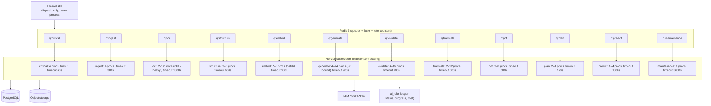
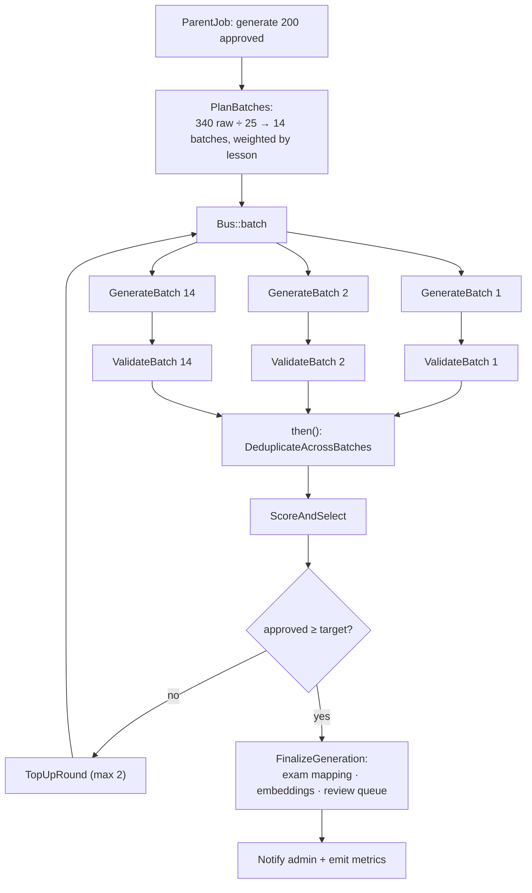

# 10 — Queue & Background Job Architecture

Covers required output **17 (queue/job architecture)**.

---

## 10.1 Topology



**Why separate queues rather than one queue with priorities:** an OCR job holding a worker
for 20 minutes must not be able to starve a 400 ms PDF render. Separate supervisors give
independent concurrency, independent timeouts, and independent autoscaling signals
(`queue_depth / throughput`).

**`q:critical`** carries only user-blocking short work: password reset mail, payment
webhook processing, attempt evaluation. It is never given AI work.

---

## 10.2 The job ledger vs Laravel's queue

Laravel's `jobs`/`failed_jobs` tables are transport. They are **not** the user-visible
record. Every unit of async work also has an `ai_jobs` row, which is:

- **Queryable** (`GET /jobs/{id}`) with progress and message
- **Hierarchical** (`parent_job_id`) so a book ingestion shows 6 child stages
- **Costed** (tokens + ₹ rolled up from `ai_invocations`)
- **Idempotent** (`idempotency_key` unique)
- **Cancellable** (a cooperative `cancelled` flag checked between batches)
- **Durable across retries** — the transport row is deleted on retry; the ledger row is not

```php
abstract class TrackedJob implements ShouldQueue
{
    use InteractsWithQueue, SerializesModels;

    public function __construct(public string $aiJobId) {}

    public function middleware(): array
    {
        return [
            new TenantAware,                       // SET LOCAL app.org_id
            new SkipIfCancelled,                   // cooperative cancellation
            (new WithoutOverlapping($this->aiJobId))->expireAfter(3600),
            new RateLimitedByProvider('llm'),      // global provider throttle
        ];
    }

    public function handle(): void
    {
        $job = AiJob::findOrFail($this->aiJobId);
        $job->markProcessing();
        try {
            $this->execute($job);                  // subclasses implement this
            $job->markCompleted();
        } catch (RetryableException $e) {
            $job->markRetryScheduled($e);
            $this->release($this->backoffSeconds());
        } catch (Throwable $e) {
            $job->markFailed($e);
            throw $e;
        }
    }

    abstract protected function execute(AiJob $job): void;

    public function backoff(): array { return [60, 300, 900]; }   // 1m, 5m, 15m
    public function retryUntil(): DateTime { return now()->addHours(6); }
}
```

---

## 10.3 Pipeline orchestration

Laravel `Bus::chain` for strictly sequential stages, `Bus::batch` for fan-out, and
`->then()` to join.

### Book ingestion (chain with an embedded batch)

```php
Bus::chain([
    new ScanForMalware($src),
    new ExtractText($src),            // branches: native vs OCR internally
    new NormalizeText($src),
    new DetectStructure($src),
    new ChunkSource($src),
    new EmbedChunksBatch($src),       // internally dispatches a Bus::batch of 64-chunk jobs
    new MapToSyllabus($src),
    new MarkSourceReady($src),
])->onQueue('ingest')
  ->catch(fn (Throwable $e) => AiJob::find($jobId)->markFailed($e))
  ->dispatch();
```

### Question generation (fan-out → fan-in)



Each `GenerateBatch` immediately chains its own `ValidateBatch` rather than waiting for a
global barrier — validation of batch 1 overlaps generation of batch 7, roughly halving
wall-clock for a 200-question run.

Cross-batch dedup **must** be a barrier (it needs all candidates at once), so it sits in
the batch's `then()` callback.

### Five prediction papers (sequential by necessity)

```php
Bus::chain(array_map(
    fn ($n) => new BuildPredictionPaper($runId, model: $n),   // shares exclusion set in Redis
    [1,2,3,4,5]
))->then(fn () => Bus::batch(
    collect(range(1,5))->flatMap(fn ($n) => [
        new RenderDocument($runId, $n, 'question_paper'),
        new RenderDocument($runId, $n, 'answer_key'),
    ])->push(new RenderDocument($runId, null, 'topic_analysis'))->all()
)->onQueue('pdf')->dispatch())->dispatch();
```

Papers are built sequentially because each must exclude the previous papers' questions;
rendering is parallel because the 11 PDFs are independent.

---

## 10.4 Job catalogue

| Job | Queue | Typical duration | Retries | Idempotency key |
|---|---|---|---|---|
| `ScanForMalware` | ingest | 5–60 s | 3 | `av:{source_id}` |
| `ExtractText` | ocr | 2–25 min | 2 | `ocr:{source_id}` |
| `NormalizeText` | structure | 10–60 s | 3 | `norm:{source_id}` |
| `DetectStructure` | structure | 30–120 s | 3 | `struct:{source_id}` |
| `ChunkSource` | structure | 20–90 s | 3 | `chunk:{source_id}` |
| `EmbedChunks` | embed | 1–8 min | 3 | `embed:{source_id}:{batch}` |
| `MapToSyllabus` | structure | 20–90 s | 3 | `map:{source_id}` |
| `GenerateQuestionBatch` | generate | 20–90 s | 3 | `gen:{parent}:{batch}` |
| `ValidateQuestionBatch` | validate | 15–60 s | 3 | `val:{parent}:{batch}` |
| `DeduplicateBatch` | validate | 10–120 s | 2 | `dedup:{parent}` |
| `ScoreAndSelect` | validate | 5–30 s | 2 | `select:{parent}` |
| `AnalyzeSyllabus` | structure | 1–5 min | 3 | `syl:{source_id}` |
| `ExtractPaperQuestions` | structure | 2–10 min | 3 | `pyq:{paper_id}` |
| `ClassifyPaperQuestions` | validate | 1–5 min | 3 | `pyqcls:{paper_id}` |
| `ComputePredictionScores` | predict | 1–10 min | 2 | `pred:{exam}:{year}:{model_v}` |
| `BuildPredictionPaper` | predict | 20–60 s | 2 | `predpaper:{run}:{n}` |
| `GenerateStudyPlan` | plan | 2–20 s | 3 | `plan:{plan_id}:{revision}` |
| `AssembleTest` | plan | 1–10 s | 3 | `test:{test_id}` |
| `TranslateQuestionBatch` | translate | 10–40 s | 3 | `tr:{lang}:{batch_hash}` |
| `ValidateTranslationBatch` | translate | 10–30 s | 3 | `trval:{lang}:{batch_hash}` |
| `RenderDocument` | pdf | 0.3–5 s | 3 | `pdf:{content_hash}` |
| `EvaluateAttempt` | critical | < 1 s | 5 | `eval:{attempt_id}` |
| `RecalibrateDifficulty` | maintenance | 5–30 min | 1 | daily |
| `RefreshTopicStats` | maintenance | 2–15 min | 1 | nightly |
| `RollupUsage` | maintenance | < 60 s | 3 | every 5 min |
| `ExpireCurrentAffairs` | maintenance | < 60 s | 1 | nightly |
| `TuneOvergenerationFactors` | maintenance | < 60 s | 1 | nightly |
| `PruneInvocationSnapshots` | maintenance | 1–5 min | 1 | nightly |

---

## 10.5 Reliability rules

**Idempotency.** Every job checks `ai_jobs.status` first; a job that finds its ledger row
`COMPLETED` returns immediately. Writes use upserts keyed on natural keys
(`(source_id, chunk_index, content_hash)`, `(question_id, language_id, translation_version)`),
so a duplicate delivery cannot create duplicate rows.

**Poison-pill protection.** `max_attempts` per job type; after exhaustion the ledger row
goes `FAILED` with `error_code`, the parent chain is marked partially failed but **other
branches continue** (a single bad chapter does not kill a 9-chapter book).

**Partial success is a first-class outcome.** `FinalizeGeneration` reports
"172 of 200 approved; shortfall in Unit 4 (insufficient source coverage)" rather than
failing. The shortfall becomes a `coverage_gaps` row.

**Cooperative cancellation.** `POST /jobs/{id}/cancel` sets `status = CANCELLED` and a
Redis flag; the `SkipIfCancelled` middleware aborts the job before its next expensive
step. Long jobs also check the flag between batches. Money already spent is still billed
and reported honestly.

**Provider throttling.** A global Redis token bucket per provider
(`llm:rpm`, `llm:tpm`) is checked by `RateLimitedByProvider`; exceeding it releases the job
with a short delay rather than burning a 429. Prevents a 24-worker generate pool from
tripping provider limits and cascading retries.

**Timeouts everywhere.** HTTP client timeout (120 s) < job timeout < supervisor timeout <
Horizon `waitTimeout`. A hung provider connection can never hold a worker indefinitely.

**Dead-letter handling.** Failed jobs land in `failed_jobs`; a maintenance job copies them
into `ai_jobs` context, groups by `error_code`, and alerts when any code exceeds 2% of
volume in an hour.

---

## 10.6 Scheduling (`app/Console/Kernel.php`)

```php
$schedule->job(new RollupUsage)->everyFiveMinutes();
$schedule->job(new RefreshTopicStats)->dailyAt('01:15');
$schedule->job(new RecalibrateDifficulty)->dailyAt('01:45');
$schedule->job(new TuneOvergenerationFactors)->dailyAt('02:10');
$schedule->job(new ExpireCurrentAffairs)->dailyAt('02:30');
$schedule->job(new GenerateDailyPlansForActiveUsers)->dailyAt('03:00');   // chunked, throttled
$schedule->job(new BuildCurrentAffairsDigest('daily'))->dailyAt('05:30');
$schedule->job(new BuildCurrentAffairsDigest('weekly'))->weeklyOn(1, '05:45');
$schedule->job(new RecomputePredictionScores)->weeklyOn(0, '04:00');
$schedule->job(new PruneInvocationSnapshots)->dailyAt('04:30');
$schedule->job(new PartitionMaintenance)->monthlyOn(25, '03:00');         // pg_partman
$schedule->job(new ReconcileSubscriptions)->hourly();
$schedule->command('horizon:snapshot')->everyFiveMinutes();
$schedule->command('backup:run')->dailyAt('23:30');
```

`GenerateDailyPlansForActiveUsers` is the one job with fan-out proportional to user count.
At 100 k users it is chunked into 500-user batches, spread over a 90-minute window with a
concurrency cap, and it only regenerates plans whose inputs actually changed (performance
delta or a new day boundary) — typically 8–12% of users per night.

---

## 10.7 Observability of the queue

| Signal | Alert threshold |
|---|---|
| `queue_depth{queue}` | > 500 for 10 min |
| `job_wait_seconds_p95{queue}` | > 5× the queue's normal |
| `job_failure_rate{type}` | > 5% over 15 min |
| `job_duration_seconds_p95{type}` | > 2× the 7-day baseline |
| `llm_error_rate{provider}` | > 2% over 5 min → circuit breaker |
| `ai_cost_inr_per_hour` | > 150% of 7-day forecast |
| Horizon supervisor down | any |
| Oldest `QUEUED` job age | > 30 min on non-ocr queues |

Every job emits an OpenTelemetry span linked to the originating HTTP request's trace id
(propagated in the job payload), so a support query — *"why is this student's paper
missing?"* — resolves to a single trace covering API → queue → worker → LLM → PDF → S3.
