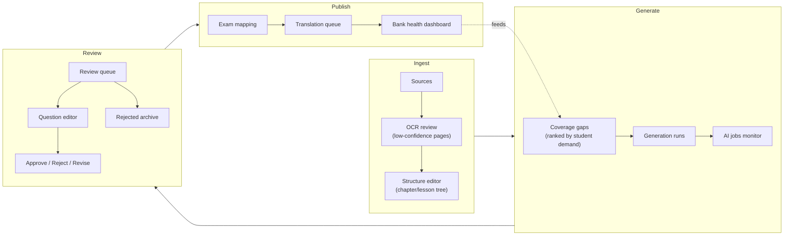
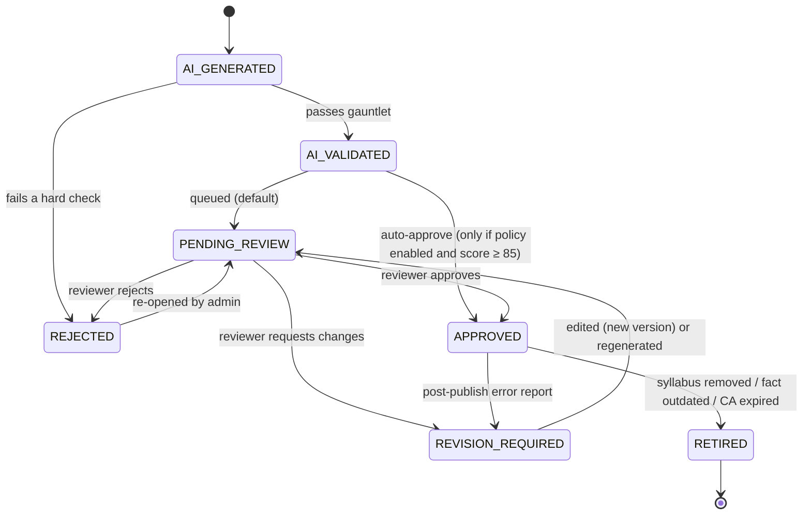
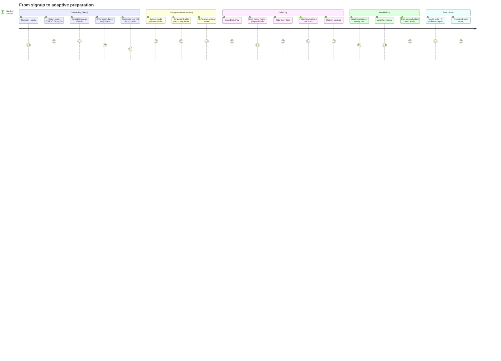
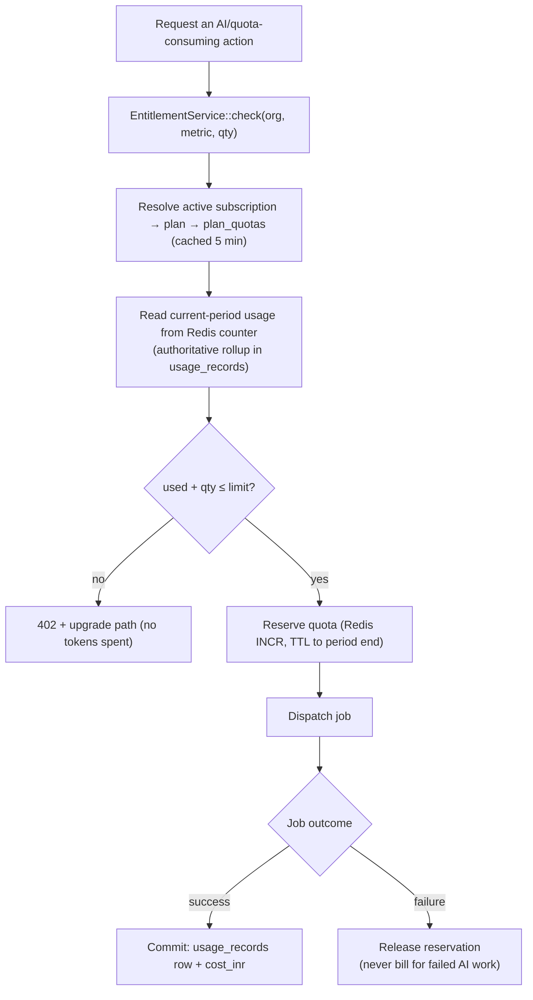
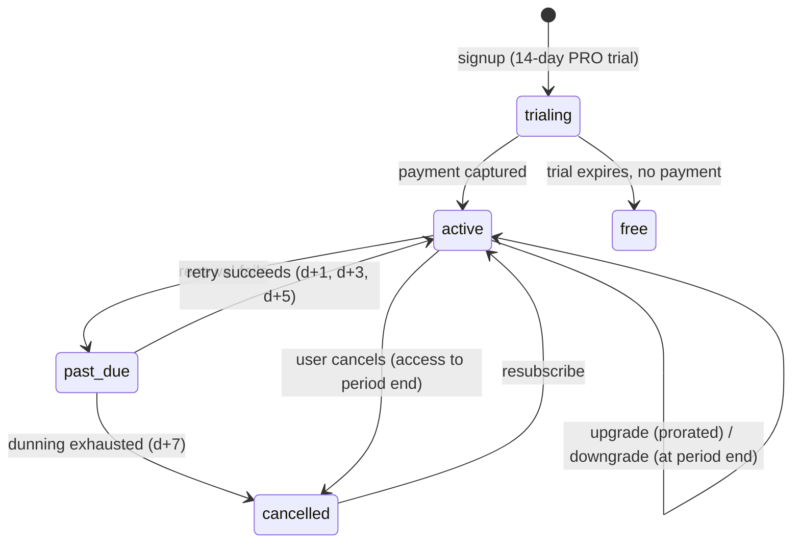

# 11 — Admin, Student & Subscription Architecture

Covers required outputs **18 (admin architecture)**, **19 (student architecture)**,
**21 (subscription architecture)** and the review workflow (spec §24).

---

## Part A — Admin / Content Operations

### 11.1 Admin is a content factory, not a settings page

The admin console is where the platform's actual asset — the question bank — is
manufactured. It is designed around throughput: how many questions can one reviewer
approve per hour, and how quickly can a coverage gap become approved content.



### 11.2 Admin navigation

```
Overview                  KPIs: bank size, approval rate, ₹/question, coverage %, job health
├─ Content
│  ├─ Exams               exam → versions → stages → papers → subjects → blueprints
│  ├─ Syllabi             upload, extraction review, version diff, publish
│  ├─ Books & Sources     upload, pipeline status, structure editor, OCR corrections
│  ├─ Previous Papers     upload, extraction review, answer-key mapping, year coverage
│  └─ Current Affairs     item editor, categories, validity windows, digests
├─ Question Bank
│  ├─ Browse              faceted: exam · topic · difficulty · language · status · source
│  ├─ Review Queue        the reviewer workstation (§11.3)
│  ├─ Rejected            with reason codes and re-open action
│  ├─ Duplicates          clustered pairs with merge/keep actions
│  └─ Bank Health         heatmap: topic × difficulty × language coverage
├─ AI Operations
│  ├─ Jobs                all types, filter by status/type/org, retry, cancel, drill to trace
│  ├─ Prompts             templates, versions, diff, evaluation results, canary, promote
│  ├─ Models              registry, pricing, tier routing, enable/disable, failover order
│  ├─ Usage & Cost        ₹ by day/org/operation/model, cache-hit ratio, forecast
│  └─ Evaluations         golden sets, gate results, regression history
├─ Prediction             per exam: scores, bands, backtest accuracy, model papers
├─ Languages              enable, fonts, glossary, translation queue, reviewer assignment
├─ Tenants
│  ├─ Organizations       plans, seats, usage, impersonate (audited)
│  ├─ Users               roles, status, MFA, sessions
│  └─ Subscriptions/Payments   invoices, refunds, dunning
├─ Analytics              platform funnels, retention, popular exams/languages, conversion
└─ System                 audit logs, feature flags, quotas, thresholds, backups status
```

### 11.3 The reviewer workstation

The single most important screen in the admin app. Optimized for **keyboard-only,
high-velocity review**:

```
┌──────────────────────────────────────────────┬─────────────────────────────┐
│ Q 143 / 257   quality 78   conf 0.88         │ SOURCE (auto-scrolled)      │
│                                              │ 6th Science › U3 › L3.2     │
│ Which organ pumps blood throughout the human │ p.42–43                     │
│ body?                                        │                             │
│   A. Lungs                                   │ "The heart is a muscular    │
│ ✓ B. Heart                                   │  organ that pumps blood to  │
│   C. Kidney                                  │  all parts of the body."    │
│   D. Liver                                   │  ← supporting quote (hl)    │
│                                              │                             │
│ Explanation: The heart is a muscular organ…  │ [view page image]           │
│                                              │                             │
│ Checks: grounding ✓ · answer 2/2 ✓ ·         │ Similar in bank:            │
│ options ✓ · difficulty easy ✓ · dup 0.71 ✓   │  • "Which organ circulates  │
│                                              │     blood…" (0.71)          │
│ [A]pprove  [R]eject  [E]dit  [V]revision     │                             │
│ [1-4] set answer  [D]ifficulty  [T]opic      │                             │
└──────────────────────────────────────────────┴─────────────────────────────┘
```

Design decisions:
- The **source is always on screen**. A reviewer must never have to go looking for the
  book — that is what makes 200 questions/hour possible instead of 40.
- Validation results are shown, not hidden: the reviewer is auditing the machine, not
  redoing its work.
- Every action is one keystroke and auto-advances.
- Edits create a `question_versions` snapshot with `changed_by` and a reason.
- Rejections require a reason code (feeds prompt tuning and factor auto-tuning).
- Reviewer metrics (throughput, override rate, agreement with peers on a 5% double-review
  sample) are tracked — that agreement rate is the gate for enabling auto-approval.

### 11.4 Review state machine



Two paths matter operationally:
- **Student error reports** (`report question` button) create a `reviews` row at high
  priority and can push an `APPROVED` question back to `REVISION_REQUIRED`. Three reports
  on one question auto-suspend it from new test selection pending review.
- **Retirement, not deletion.** A retired question stays attached to past attempts so a
  student's history remains explainable.

---

## Part B — Student Architecture

### 11.5 Student information architecture

```
Dashboard            today's plan · streak · next test · weakest 3 topics · progress ring
My Exams             enrolled exams, exam dates, countdown, syllabus coverage %
Study Plan
  ├─ Daily           today's topics, reading refs (book + pages), daily test, mark-complete
  ├─ 3-Day           cycle view: new / new+revision / revision+test
  ├─ Weekly          Mon–Sun grid, weekly revision, weekly test
  └─ Monthly         4-week blocks, week tests, monthly test
Question Bank        browse/practice by exam · subject · topic · difficulty · language
Tests
  ├─ Daily Test      20 Q
  ├─ 3-Day Test      50 Q
  ├─ Weekly Test     75 Q
  ├─ Monthly Test    100 Q
  ├─ Model Tests     full blueprint simulation, timed, OMR-style
  └─ Prediction Tests  5 model papers + topic report
Results              attempt history, score trend, percentile, solutions with citations
Analytics            topic mastery heatmap, difficulty accuracy, time/question, weak areas
Downloads            all generated PDFs: view · preview · download · regenerate · share
Language             interface + content language
Subscription         plan, usage meters, upgrade
Profile              exam preferences, study hours, off days, notifications
```

Each plan mode is a **separate page** (spec requirement), sharing one `PlanView` component
parameterized by mode — separate routes and separate navigation, one implementation.

### 11.6 Student journey



### 11.7 Document actions

Every generated document supports the five actions from the spec:

| Action | Behaviour | Cost |
|---|---|---|
| **View** | In-browser PDF.js viewer, streamed via signed URL | ₹0 |
| **Preview** | Cached first-page PNG thumbnail (rendered once) | ₹0 |
| **Download** | 302 to a 5-minute signed URL; `download_count++` | ₹0 |
| **Regenerate** | New selection → new document row (old one preserved) | Quota-metered |
| **Share** | Signed public link, optional password/expiry/limit, revocable | ₹0 |

The UI states plainly that Download re-serves the stored file, and Regenerate creates a
new paper — so a teacher never accidentally invalidates a paper already given to a batch.

### 11.8 Offline & low-bandwidth reality

Most of this audience studies on mid-range Android phones on patchy connections.

- PDFs are the offline artifact: download once, study anywhere. This is why materialized
  documents matter beyond cost.
- Tests support **offline attempt mode**: the paper is cached in IndexedDB, answers are
  buffered locally, and submitted when connectivity returns (idempotent submit by
  `attempt_id` + client answer hash).
- Next.js PWA with a service worker caching the app shell, the current daily plan and the
  active test.
- Payloads are small: no option text before an attempt, cursor pagination, `?include=`
  whitelisting, Brotli, and image-free question rendering by default.

---

## Part C — Subscription & Metering

### 11.9 Plans

| | FREE | BASIC ₹99/mo | PRO ₹299/mo | PREMIUM ₹599/mo | INSTITUTE ₹4,999/mo |
|---|---|---|---|---|---|
| Exams | 1 | 2 | 5 | All | All |
| Languages | 1 | 2 | All | All | All |
| Question practice/day | 30 | 200 | Unlimited | Unlimited | Unlimited |
| Study plans | Daily only | Daily + Weekly | All 4 modes | All 4 modes | All + batch plans |
| Model tests/mo | 1 | 4 | 15 | Unlimited | Unlimited |
| Prediction papers | ✗ | ✗ | 5/season | 5/season + report | 5/season + report |
| PDF downloads/mo | 5 | 50 | 300 | Unlimited* | Unlimited* |
| Own material upload | ✗ | ✗ | 3 files | 20 files | 500 files |
| Own question generation | ✗ | ✗ | 200/mo | 1,000/mo | 10,000/mo |
| Seats | 1 | 1 | 1 | 1 | 50 (+₹79/extra) |
| Branding on PDFs | ✗ | ✗ | ✗ | ✗ | ✓ |
| Batch dashboard & analytics | ✗ | ✗ | ✗ | ✗ | ✓ |
| API access | ✗ | ✗ | ✗ | ✗ | ✓ |

\* fair-use ceiling enforced via `plan_quotas` (a real number in the DB, never "unlimited"
in code).

**Every one of these numbers is a `plan_quotas` row.** Changing a limit is a DB update and
a cache bust — no deploy. This is the difference between a pricing experiment taking an
hour and taking a sprint.

### 11.10 Entitlement and metering



Reserve-then-commit prevents both over-spend (two concurrent requests each seeing 499/500)
and unfair billing (a job that failed on our side).

Usage is exposed to the student continuously: `GET /api/v1/usage` powers meters in the UI,
because surprise 402s at 11 p.m. before an exam are how you lose a subscriber.

### 11.11 Billing lifecycle



- Razorpay for UPI/cards/netbanking; webhooks signature-verified, replay-protected by
  `event_id`, and **re-fetched from the provider** before granting entitlement.
- Upgrades take effect immediately with proration; downgrades at period end (never remove
  access a student paid for mid-cycle).
- GST-compliant invoices generated as PDFs by the same document engine.
- Grace behaviour on `past_due`: reads and downloads of already-generated documents stay
  available; new AI generation is blocked. Students keep their study plan even when a
  payment fails — punishing them at that moment costs more in churn than the ₹99.
- Institute seats: `organization_users` count checked against `plan_quotas.seats`;
  over-seat invites are blocked with an upsell.
