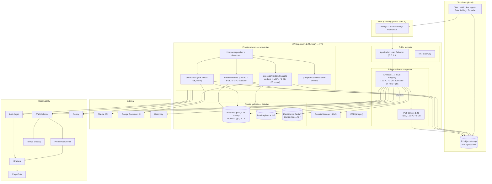
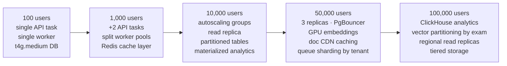
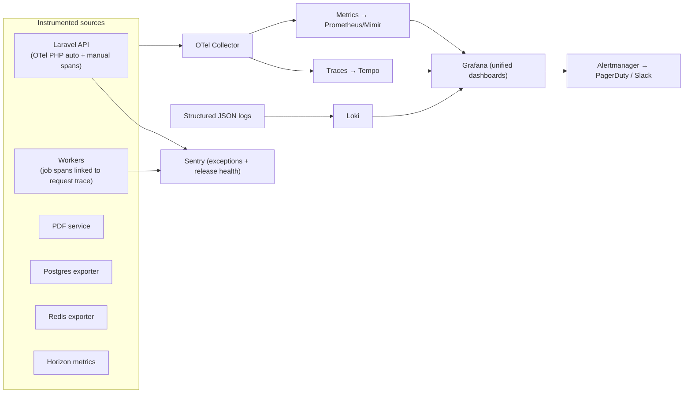

# 13 — Deployment, Infrastructure, Scaling & Monitoring

Covers required outputs **23 (deployment architecture)**, **28 (monitoring architecture)**,
**31 (infrastructure estimates)** and **32 (scaling 100 → 100,000 users)**.

---

## 13.1 Deployment topology



**Why AWS + Cloudflare split:** Postgres with pgvector and long-running workers want a
real VPC (RDS + ECS). PDFs and books are download-heavy, and R2's zero egress converts the
single largest variable infra cost into zero. Next.js sits wherever deploys are fastest.

**Containers**
| Image | Base | Notes |
|---|---|---|
| `api` | `php:8.3-fpm-alpine` + nginx | Opcache + JIT, preloading, no dev deps |
| `worker` | same as api | Different entrypoint (`horizon`), higher memory limits |
| `pdf` | `debian-slim` + typst + Noto fonts | Stateless HTTP, no DB access |
| `ocr-sandbox` | `debian-slim` + poppler + tesseract | Read-only FS, no egress except OCR API, seccomp profile |

**Deploy pipeline:** GitHub Actions → test + PHPStan L8 + Pint + tenancy suite → build →
ECR → migration gate (expand-only migrations run before deploy; contract migrations run
after a full rollout) → blue/green ECS deploy → smoke tests → shift traffic.

**Zero-downtime migrations:** expand → deploy → backfill → contract. Never drop or rename a
column in the same release that stops using it.

---

## 13.2 Infrastructure sizing & cost by stage

### Stage 1 — MVP / pilot (≤ 1,000 users, 1 exam, 2 languages)

| Component | Spec | ₹/month |
|---|---|---|
| API | 2 × Fargate 1 vCPU/2 GB | 5,500 |
| Workers | 2 × Fargate 2 vCPU/4 GB | 8,000 |
| PDF service | 1 × Fargate 1 vCPU/1 GB | 2,500 |
| RDS Postgres | db.t4g.medium Multi-AZ, 100 GB gp3 | 12,000 |
| Redis | cache.t4g.small | 3,000 |
| R2 storage | 200 GB + zero egress | 400 |
| Cloudflare | Pro | 1,700 |
| Next.js hosting | Vercel Pro | 1,700 |
| Monitoring | Grafana Cloud free + Sentry team | 2,000 |
| **Infra subtotal** | | **~36,800** |
| AI (content build: ~60 books, 20k questions, Tamil) | one-time-ish | 60,000–90,000 |
| AI (steady state: student usage) | | 2,000–5,000 |
| **Total month 1–3** | | **~₹1.0–1.3 L/month** |

Content build is front-loaded: once 20,000 questions exist, monthly AI cost collapses.

### Stage 2 — Growth (10,000 users, 3 exams, 4 languages)

| Component | Spec | ₹/month |
|---|---|---|
| API | 4–8 × Fargate 1 vCPU/2 GB (autoscaled) | 18,000 |
| Workers | 6–12 tasks across pools | 35,000 |
| PDF | 2–4 tasks | 8,000 |
| RDS | db.r6g.large Multi-AZ + 1 replica, 500 GB | 55,000 |
| Redis | cache.r6g.large | 14,000 |
| R2 | 2 TB | 3,000 |
| CDN/WAF/monitoring | | 12,000 |
| **Infra subtotal** | | **~1.45 L** |
| AI (incremental content + translations) | | 60,000 |
| **Total** | | **~₹2.0 L/month** |

At ~₹149 blended ARPU × 10,000 users = ₹14.9 L revenue → healthy gross margin.

### Stage 3 — Scale (100,000 users, 10+ exams, 8 languages)

| Component | Spec | ₹/month |
|---|---|---|
| API | 15–40 tasks | 90,000 |
| Workers | 25–60 tasks + GPU node for embeddings | 2,20,000 |
| PDF | 6–12 tasks | 30,000 |
| RDS | db.r6g.2xlarge Multi-AZ + 3 replicas, 2 TB | 2,20,000 |
| Redis | cluster, 3 shards | 55,000 |
| R2 | 20 TB | 28,000 |
| ClickHouse (analytics) | managed, 3 nodes | 60,000 |
| CDN/WAF/observability | | 60,000 |
| **Infra subtotal** | | **~7.6 L** |
| AI | | 2,50,000 |
| **Total** | | **~₹10 L/month** |

Revenue at 100 k users × ₹149 ≈ ₹1.5 Cr/month. **Infra + AI ≈ 7% of revenue** — the
architecture's whole purpose.

---

## 13.3 Scaling strategy — 100 → 100,000 users



### What breaks first, and the fix

| Users | First bottleneck | Fix | Cost of fix |
|---|---|---|---|
| ~1 k | Queue depth during content builds | Split queues, scale worker pool | Low |
| ~5 k | Postgres connections | PgBouncer (transaction pooling), `pool_size` tuning | Low |
| ~10 k | Analytics queries on OLTP | Read replicas + nightly materialized views | Low |
| ~20 k | `test_answers` table size (100 M+ rows) | Monthly partitions, archive > 24 months to S3 | Low |
| ~30 k | Vector search latency as bank hits 1 M+ | Partition `question_embeddings` by exam/subject; tune `ef_search`; pre-filter by topic | Medium |
| ~50 k | Nightly daily-plan generation window | Chunked + spread + only-if-changed regeneration | Low |
| ~50 k | PDF render throughput at 7 a.m. peak | Scale PDF tasks; pre-render daily documents at 3 a.m.; CDN-cache signed responses | Low |
| ~70 k | LLM provider rate limits during content builds | Batch API for bulk, multi-key rotation, off-peak scheduling | Low |
| ~100 k | Analytics writes | ClickHouse for attempt-level events; Postgres keeps aggregates | Medium |
| ~150 k+ | Single-primary write ceiling | Shard by `organization_id` (biggest tenants first) or move attempts to a dedicated cluster | High — defer as long as possible |

### Scaling principles

1. **Stateless app tier** — scale by adding tasks; sessions in Redis, files in R2, no local
   disk dependency.
2. **Read/write split** — reporting, question browsing and analytics on replicas; a single
   `->onWriteConnection()` for read-after-write paths.
3. **Scale the queue, not the request** — user-visible latency stays flat because nothing
   heavy is synchronous.
4. **Precompute the predictable** — daily plans, daily digests, popular model papers are
   rendered before the morning peak.
5. **Cache the shared** — platform content (exams, syllabi, approved question metadata) is
   identical for every tenant and is cached aggressively; tenant-private data is not.
6. **Partition before it hurts** — partitioning at 10 M rows is a maintenance window; at
   500 M it is an outage.

### Autoscaling signals

| Pool | Scale-out on | Scale-in |
|---|---|---|
| API | RPS/task > 60 or p95 > 400 ms | < 40% CPU for 15 min |
| Workers (per queue) | `queue_depth / throughput > 120 s` | depth 0 for 10 min |
| PDF | pending renders > 50 | idle 10 min |
| Read replicas | replica CPU > 70% sustained | manual |

---

## 13.4 Reliability & disaster recovery

| Concern | Target | Mechanism |
|---|---|---|
| API availability | 99.9% | Multi-AZ, ≥2 tasks, health checks, blue/green |
| RPO | 5 min | RDS PITR (WAL) + Redis AOF |
| RTO | 1 h | Automated restore runbook, quarterly drill |
| Backups | Daily full + continuous WAL, 30-day retention, cross-region copy | |
| Object storage | Versioning + lifecycle (sources: infrequent access after 90 d) | |
| Provider outage | Degrade, don't fail: fallback model tier → queue and retry → user sees "queued" not "error" | |
| Postgres failover | Multi-AZ automatic; app retries with exponential backoff | |
| Data deletion | Soft delete + 30-day recovery window before hard purge | |

**Degradation ladder** — the platform stays useful as components fail:
1. LLM provider down → generation queues, **everything already generated still works**
   (this is the payoff of materialization).
2. OCR down → uploads accepted and queued; existing content unaffected.
3. PDF service down → in-app viewing works; downloads queue.
4. Redis down → API serves reads; writes that need queues return 503 with retry guidance.
5. Primary DB failover → 30–60 s of write errors, automatic recovery.

---

## 13.5 Monitoring architecture



### Dashboards

| Dashboard | Panels |
|---|---|
| **Platform health** | RPS, p50/p95/p99 latency, 5xx rate, task count, DB connections, replica lag |
| **Queue health** | Depth and wait time per queue, throughput, failure rate, oldest job age |
| **AI operations** | Calls/min by model+operation, token throughput, ₹/hour, cache-hit %, error/degradation rate, schema-repair rate |
| **Content factory** | Questions generated / validated / approved / rejected per day, rejection-code mix, ₹ per approved question, reviewer throughput, coverage gaps |
| **Quality** | Grounding pass rate, answer-agreement rate, duplicate rate, post-publish error reports per 1,000 served, translation validation pass rate |
| **Student experience** | DAU/MAU, plan completion %, test attempts, p95 attempt-submit latency, PDF download success, offline-sync failures |
| **Business** | Signups, trial→paid conversion, MRR, churn, ARPU, plan mix, quota-block events (a leading upsell signal) |

### Alerts (page vs ticket)

**Page (on-call):** API 5xx > 2% for 5 min · DB CPU > 90% for 10 min · replica lag > 60 s ·
any queue depth > 2,000 · LLM error rate > 20% for 10 min · payment webhook failures > 5 in
10 min · daily AI spend > 200% of forecast · backup failure.

**Ticket (business hours):** rejection rate for a code > 15% · reviewer queue > 2,000 ·
coverage gaps > 50 for an active exam · cache-hit ratio < 40% · p95 PDF render > 5 s ·
prompt-version quality regression.

### Traceability requirement (spec §35)

Every approved question can be reconstructed end-to-end:

```
question_id
 → question_versions (who edited what, when)
 → question_sources (book, chapter, page, chunk, quote)
 → ai_jobs (the run)   → ai_invocations (each model call)
 → prompt_versions (exact prompt text + schema + params)
 → ai_models (model + pricing at the time)
 → question_validations (each check, its verdict, its evidence)
 → reviews + review_comments (human decisions)
 → cost_inr (what this question cost to make)
```

This is one `GET /api/v1/admin/questions/{id}/lineage` call. It is what makes the platform
auditable to a government content partner — and what lets you answer "why is this question
wrong?" in two minutes instead of two days.
