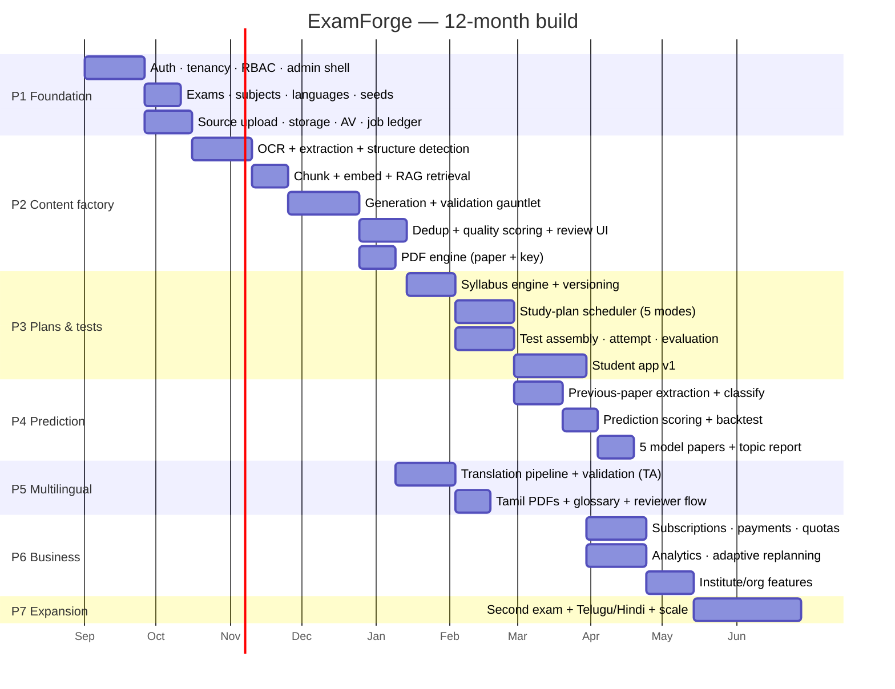

# 14 — Roadmap & Implementation Order

Covers required outputs **29 (MVP roadmap)**, **30 (Phase 2/3 roadmap)** and
**33 (recommended implementation order)**.

---

## 14.1 Guiding sequence

> Build the **content factory** before the **student product**. A beautiful student app
> with 200 mediocre questions fails. A plain student app on 20,000 source-grounded,
> reviewed questions wins.

Concretely: Phases 1–2 create the asset. Phase 3 makes it consumable. Phase 4 makes it
differentiated. Phase 5 makes it accessible. Phase 6 makes it a business. Phase 7 makes it
big.

---

## 14.2 Phase timeline

---

## 14.3 Phase detail

### Phase 1 — Foundation (weeks 1–6)

**Ship:** an admin can log in, create an exam, upload a book, and watch a job run.

- Laravel skeleton, Postgres + pgvector, Redis, Horizon, R2, CI
- `organizations`, `users`, `organization_users`, roles/permissions (teams mode)
- Three-layer tenancy + the cross-tenant leak test suite
- `ai_jobs` ledger + `TrackedJob` + job status API + SSE
- `sources` upload (presigned), AV scan, storage
- Exams/subjects/languages CRUD + TNPSC Group IV seed
- `AiGateway` skeleton with the **fake** LLM driver, `prompt_templates`/`prompt_versions`
- Next.js shell: auth, admin layout, job monitor

**Exit criteria:** a book uploads, a stub job runs to COMPLETED, and the tenancy suite is
green. Zero real AI spend so far.

### Phase 2 — Content factory (weeks 7–18) ← *the critical phase*

**Ship:** 200+ reviewed, source-grounded questions from one real textbook, as PDFs.

- OCR branch (digital vs scanned), Document AI + Tesseract adapters, Tamil normalization
- Structure detection (heuristics + cheap LLM), structure editor, OCR correction UI
- Chunking, embeddings, HNSW, hybrid retrieval, context packer
- Generation: batch planner, overgeneration, structured output, schema repair
- Validation gauntlet V1–V10, quality scoring, rejection ledger
- Duplicate detection L1/L2/L3
- Reviewer workstation (source pane + keyboard flow)
- PDF engine: question paper + answer key + explanations, English

**Exit criteria (the real MVP gate):**
- 6th–10th Science + Social Science ingested (≈10 books)
- ≥ 2,000 approved questions, **100% with citations**
- Reviewer override rate < 15%
- Cost per approved question < ₹6
- A generated 100-question paper reviewed by a domain expert scores ≥ 90% acceptable

*Do not proceed to Phase 3 until this gate passes.* Everything downstream inherits this
quality.

### Phase 3 — Syllabus, plans, tests (weeks 19–30)

- Syllabus extraction, hierarchy, versioning, diff, publish
- Canonical topic taxonomy + mapping (book ↔ syllabus ↔ question)
- `PlanScheduler` + the five plan modes + their PDFs
- Blueprints, `SelectionEngine`, test assembly
- Attempt runner (offline-capable), evaluation, results, solutions with citations
- Student app: dashboard, plans, tests, results, downloads

**Exit criteria:** a student registers, gets a plan to their exam date, takes a daily test,
sees results with source citations, and downloads three PDFs — with no LLM call in the
whole flow.

### Phase 4 — Prediction (weeks 31–38)

- Previous-paper ingestion (target: 10 years of TNPSC Group IV + Group II)
- Question extraction, official-key mapping, constrained topic classification
- Cross-year repeat linking
- Frequency/recency/trend analysis, prediction scoring, isotonic calibration
- **Back-testing** and the published accuracy number
- Five model papers with semantic cross-exclusion + 11 PDFs
- Important/Repeated Topic Analysis report

**Exit criteria:** back-test on the most recent year shows Very-High-band topics supplying
≥ 60% of actual questions, and every prediction surface carries the disclaimer.

### Phase 5 — Multilingual (weeks 33–42, overlaps P4)

- Translation pipeline with placeholder masking + glossary
- Five-stage translation validation including independent re-solve
- Tamil glossary seeded from state-board terminology (~2,000 terms)
- Tamil PDF rendering (fonts, shaping, layout QA)
- Native reviewer workflow for the first 500 questions
- Language switcher across the app

**Exit criteria:** 1,000 Tamil questions at ≥ 95% validation pass; a native Tamil teacher
rates a 50-question Tamil paper ≥ 4.5/5 for correctness and register.

### Phase 6 — Business & intelligence (weeks 39–52)

- `subscription_plans` + `plan_quotas` + entitlement/metering + reserve-commit
- Razorpay checkout, webhooks, invoices, dunning
- Student analytics: mastery heatmap, weak topics, trends, streaks
- Adaptive replanning
- Organization features: seats, batches, teacher dashboard, branded PDFs, bulk assignment
- Admin analytics: cost, conversion, bank health, reviewer productivity

### Phase 7 — Expansion (year 2)

- Second exam family (TNPSC Group II / TNUSRB) — reuses the bank via canonical topics
- Telugu, Malayalam, Hindi, Kannada
- National exams (SSC, RRB, Banking) — mostly content ops, minimal engineering
- Scale work from doc 13 §13.3
- Optional: mobile app, live classes, doubt-solving, peer leaderboards

---

## 14.4 First MVP scope (spec §37) — precisely bounded

**In scope**

| Area | Scope |
|---|---|
| Exam | TNPSC Group IV only |
| Languages | English + Tamil |
| Sources | TN State Board Std 6–10 (Science, Social Science, Tamil, English) + 8 years of previous papers + official syllabus |
| Generation | 200+ questions per book, validated, reviewed, cited |
| Plans | Daily · 3-Day · Weekly · Monthly · Model Test |
| Prediction | Topic frequency, prediction scores, five model papers, repeated-topic report |
| Documents | Question paper, answer key, explanations, study plan, prediction report |
| Tenancy | Individual students + a handful of pilot institutes |
| Billing | Free + one paid plan (add the full matrix in Phase 6) |

**Explicitly out of scope for MVP**

Other exams · other languages · descriptive/subjective questions · live classes · mobile
apps · doubt forums · video content · public API · white-label · AI tutoring chat.

Each of these is a real product; none of them makes the first version work.

---

## 14.5 Recommended implementation order (build sequence)

1. **Migrations + tenancy + RLS + the leak test.** Everything sits on this; retrofitting
   tenancy is a rewrite.
2. **`ai_jobs` ledger + `TrackedJob` + job API.** Every later feature is a job.
3. **`AiGateway` + prompt registry with a fake driver.** Build the discipline before
   spending money.
4. **Source upload + storage + AV.** Boring, blocking, unglamorous — do it early.
5. **OCR + normalization.** Tamil correctness here determines everything downstream.
6. **Structure detection + the structure editor.** Fix data at the source, not in prompts.
7. **Chunking + embeddings + retrieval.** Verify retrieval quality manually before
   generating anything.
8. **Generation with structured output.** Now spend the first real rupees.
9. **Validation gauntlet.** Ship it *with* generation, never after — unvalidated questions
   in the bank are technical debt you cannot pay down.
10. **Dedup + quality scoring.**
11. **Reviewer workstation.** The moment a human can approve at speed, content scales.
12. **PDF engine.** First tangible deliverable for users.
13. **Syllabus engine + canonical taxonomy.**
14. **Selection engine + blueprints + test assembly.**
15. **Plan scheduler + the five modes.**
16. **Student app + attempt runner + results.**
17. **Previous papers + prediction + model papers.**
18. **Translation + Tamil PDFs.**
19. **Subscriptions + metering + payments.**
20. **Analytics + adaptive replanning + institute features.**

### Anti-patterns to avoid (each is a real, expensive mistake)

| Anti-pattern | Consequence |
|---|---|
| Building the student UI first | Beautiful shell, empty bank, no product |
| Skipping validation "for now" | Wrong answer keys reach students; trust is unrecoverable |
| Generating questions without citations | Cannot verify, cannot defend, cannot fix at source |
| Storing question text per exam | Combinatorial duplication; bank becomes unmaintainable |
| Translating everything upfront | Pays for languages nobody requested |
| Synchronous AI in HTTP | Timeouts, retries, duplicate spend, angry users |
| Hardcoding quotas/thresholds | Every pricing experiment becomes a deploy |
| Adding a second exam before the first is stable | Doubles the surface, halves the quality |
| Retrofitting tenancy later | Rewrite |
| Promising prediction accuracy | Regulatory and reputational risk |

---

## 14.6 Team shape

| Phase | Backend | Frontend | AI/ML | Content ops | DevOps |
|---|---|---|---|---|---|
| P1–P2 | 2 | 1 | 1 | 1 (subject expert) | 0.5 |
| P3 | 2 | 2 | 1 | 2 | 0.5 |
| P4–P5 | 2 | 2 | 1 | 3 (incl. Tamil reviewer) | 0.5 |
| P6–P7 | 3 | 2 | 1 | 4–6 | 1 |

The content-ops line grows fastest, and that is correct: after Phase 2 the bottleneck is
never engineering, it is **how fast reviewed questions enter the bank**.
