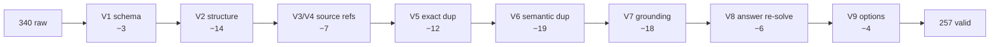

# 15 — End-to-End Worked Example

Covers required output **36**: `6th Standard Science PDF` → 200+ questions → Tamil
translation → Question Paper PDF → Answer Key PDF.

Every number below is a realistic estimate for a 168-page TN State Board textbook.

---

## 15.1 Timeline overview

```mermaid
gantt
    title One book → 200+ bilingual questions → PDFs
    dateFormat HH:mm
    axisFormat %H:%M
    section Ingestion
    Upload + AV scan          :a1, 00:00, 3m
    Text extraction (OCR)     :a2, after a1, 22m
    Normalize + structure     :a3, after a2, 4m
    Chunk + embed             :a4, after a3, 7m
    Syllabus mapping          :a5, after a4, 2m
    section Generation
    Plan 14 batches           :b1, after a5, 1m
    Generate 340 raw          :b2, after b1, 11m
    Validate (overlapped)     :b3, after b1, 14m
    Dedup + score + select    :b4, after b3, 3m
    section Human
    Review 257 questions      :c1, after b4, 90m
    section Output
    Tamil translation (210)   :d1, after c1, 9m
    Render 4 PDFs             :d2, after d1, 1m
```



**Machine time: ~78 minutes. Human review: ~90 minutes. Total AI cost: ~₹690.**

---

## 15.2 Step 1 — Upload

```http
POST /api/v1/uploads/presign
{ "filename": "6th_standard_science_tn_em.pdf", "mime": "application/pdf",
  "size": 48219884 }
→ { "url": "https://r2.../quarantine", "fields": {...}, "key": "quarantine/018f.../src.pdf" }

POST /api/v1/sources
{
  "kind": "textbook",
  "title": "6th Standard Science — Tamil Nadu State Board (English Medium)",
  "storage_key": "quarantine/018f.../src.pdf",
  "language_id": "<en>",
  "rights_basis": "govt_open",
  "meta": { "board":"TN State Board", "standard":"6", "subject":"Science",
            "publication_year": 2024 }
}
→ 201 { "source_id": "018e9a1c-...", "status": "uploaded" }

POST /api/v1/sources/018e9a1c-.../process
→ 202 { "job_id": "018f1000-...", "type": "ingestion", "estimated_seconds": 2280 }
```

Rows created: `sources` (1), `books` (1), `ai_jobs` (1 parent + 7 children).

---

## 15.3 Step 2 — Ingestion

| Stage | What happened | Result | Cost |
|---|---|---|---|
| AV scan | ClamAV in quarantine | clean → promoted to `sources/` | ₹0 |
| Text detection | 168 pages; only 41 have a usable text layer | → OCR path | ₹0 |
| OCR | Document AI, 300 DPI, `en` + `ta` hints | 168 pages, mean confidence 0.972; 3 pages < 0.80 → re-OCR at 400 DPI → 2 recovered, 1 flagged | ₹126 |
| Normalize | NFC, de-hyphenation, header/footer strip, 2-column reorder | `book_pages` 168 rows | ₹0 |
| Structure | Bookmarks + numbering + typography, then Haiku repair over 214 candidate headings | 5 units, 22 lessons, 22 exercise blocks | ₹2.60 |
| Exercises | Book-back questions extracted separately | 186 seed questions (`origin = textbook_exercise`) | ₹0 |
| Chunk | 350–600 tokens, 15% overlap, lesson-bounded | **412 chunks** (368 prose, 22 definition, 14 table, 8 callout) | ₹0 |
| Embed | multilingual-e5-large, 64/batch, self-hosted | 412 vectors, HNSW built | ₹4 (compute) |
| Map | Lesson → canonical topic vector match | 22 lessons → 34 canonical topics; **TNPSC G4 GS-Science coverage: 71%** | ₹1.20 |

**Ingestion total: ₹133.80. `sources.status = ready`.**

Sample chunk:

```json
{ "id":"018e9b77-...", "chunk_index":187, "chunk_type":"prose",
  "book_lesson_id":"018e9b10-...", "page_start":42, "page_end":43,
  "breadcrumb":"6th Science (EN) › Unit 3 Living World › Lesson 3.2 Circulatory System › pp.42-43",
  "text":"The heart is a muscular organ located slightly to the left of the chest cavity. It pumps blood to all parts of the body through blood vessels. The human heart has four chambers — two atria and two ventricles...",
  "token_count":438, "importance":0.81 }
```

---

## 15.4 Step 3 — Question generation

```http
POST /api/v1/questions/generate
Idempotency-Key: gen-6sci-full-v1
{
  "scope": { "book_id": "018e9a1d-..." },
  "exam_id": "<TNPSC_G4>",
  "target_count": 200,
  "difficulty_mix": { "easy":0.40, "medium":0.40, "hard":0.20 },
  "language_id": "<en>",
  "options": { "auto_map_exams": ["TNPSC_G4","TNUSRB_PC","SSC_CGL","RRB_NTPC"] }
}
→ 202 { "job_id":"018f2000-...", "planned": {"raw_questions":340,"batches":14},
        "estimated_cost_inr": 412.50 }
```

**Batch plan** — 340 raw questions distributed across 22 lessons weighted by
`chunk_count × mean_importance × syllabus_weight`:

| Unit | Lessons | Chunks | Raw target |
|---|---|---|---|
| 1 Measurement | 4 | 71 | 52 |
| 2 Matter | 4 | 78 | 58 |
| 3 Living World | 6 | 112 | 96 |
| 4 Energy & Force | 5 | 89 | 76 |
| 5 Environment | 3 | 62 | 58 |

Per batch (25 questions): retrieve top-12 chunks for the lesson → pack ~5.4 k tokens →
generate. 14 calls, mean 41 s each, run 6-wide.

**One generated candidate (raw):**

```json
{
  "question_text": "Which organ pumps blood throughout the human body?",
  "options": { "A":"Lungs", "B":"Heart", "C":"Kidney", "D":"Liver" },
  "correct_option": "B",
  "explanation": "The heart is a muscular organ that pumps blood to all parts of the body through blood vessels.",
  "difficulty": "easy", "bloom_level": "remember",
  "topic": "Circulatory System", "subtopic": "Heart",
  "source_refs": ["S4"],
  "supporting_quote": "It pumps blood to all parts of the body through blood vessels.",
  "confidence": 0.96
}
```

**Generation cost:** 612 k input + 288 k output tokens ≈ **₹438**.

---

## 15.5 Step 4 — Validation gauntlet

340 raw → the funnel:



| Stage | Rejected | Example reject |
|---|---|---|
| V1 `SCHEMA_INVALID` | 3 | Missing `supporting_quote` |
| V2 `OPTION_INVALID` | 14 | Options B and D identical after normalization |
| V2 `ANSWER_LEAK` | — | (0 this run) |
| V3/V4 `SOURCE_UNRESOLVED` | 7 | Cited `S13` when only 12 chunks were sent |
| V5 `DUPLICATE_EXACT` | 12 | Same stem generated in batches 6 and 9 |
| V6 `DUPLICATE_SEMANTIC` | 19 | "Which organ circulates blood?" vs "Which organ pumps blood?" (0.94) |
| V7 `UNSUPPORTED` | 18 | "The human heart beats 72 times per minute" — not in this book |
| V8 `ANSWER_MISMATCH` | 6 | Key said C, both verifier models chose A |
| V9 `DISTRACTOR_WEAK` | 4 | Three options obviously absurd |
| **Valid** | **257** | mean quality 82.4 |

All 83 rejects are stored in `questions` (`status = REJECTED`) with
`question_rejections` rows — none deleted.

**Our example question's scorecard:**

| Component | Value | Weight | Points |
|---|---|---|---|
| Grounding (verbatim quote matched chunk 187 at 0.97) | 1.00 | 22 | 22.0 |
| Answer agreement (2/2 models chose B) | 1.00 | 20 | 20.0 |
| Option quality | 0.95 | 15 | 14.3 |
| Distinctiveness (max bank similarity 0.71) | 0.85 | 12 | 10.2 |
| Language quality | 0.98 | 10 | 9.8 |
| Difficulty confidence | 0.92 | 8 | 7.4 |
| Exam alignment (maps to TNPSC G4 GS → Science → Human Body) | 1.00 | 8 | 8.0 |
| Explanation quality | 0.96 | 5 | 4.8 |
| **quality_score** | | | **96.5** |

**Validation cost:** ~₹142 (grounding + re-solve + option checks, all batched).

---

## 15.6 Step 5 — Human review

257 questions enter the review queue. A subject-expert reviewer at ~170 questions/hour:

| Decision | Count |
|---|---|
| Approved unchanged | 198 |
| Approved after edit (wording/difficulty) | 26 |
| Revision required | 19 |
| Rejected | 14 |

**224 approved.** Target was 200 — met with margin. Reviewer override rate 15.6%
(edits + rejects), so auto-approval stays off for this subject until it drops below 5%.

Approving our example writes:

```
questions:               status APPROVED, quality 96.5, approved_by, approved_at
question_options:        A(f) B(t) C(f) D(f)
question_translations:   en (is_master, HUMAN_APPROVED)
question_sources:        source 018e9a1c, lesson 3.2, pp.42–43, chunk 018e9b77, quote
question_topic_mappings: canonical 'human-circulatory-system' (primary)
question_exam_mappings:  TNPSC_G4 0.95 · TNUSRB_PC 0.90 · SSC_CGL 0.72 · RRB_NTPC 0.75
question_embeddings:     en vector(1024)
question_versions:       v1 snapshot
```

**One row of question text. Four exams. Zero duplication.** Requesting the same question
for SSC costs nothing.

---

## 15.7 Step 6 — Tamil translation

A student selects Tamil and requests a 50-question test; the assembler finds 210 of the
selected/candidate pool lack a Tamil translation, and queues them (batched 15 per call).

Masking first:

```
Source:  "Which organ pumps blood throughout the human body?"
Masked:  "Which organ pumps blood throughout the human body?"     (no protected spans here)

Source:  "The human heart has __PH_1__ chambers."                 (4 → __PH_1__)
```

Translated + validated:

```json
{
  "question_id": "018f5d01-...",
  "language": "ta",
  "source_language": "en",
  "question_text": "மனித உடலில் இரத்தத்தை உந்தித் தள்ளும் உறுப்பு எது?",
  "option_a": "நுரையீரல்", "option_b": "இதயம்",
  "option_c": "சிறுநீரகம்", "option_d": "கல்லீரல்",
  "explanation": "இதயம் ஒரு தசை உறுப்பு ஆகும். இது இரத்தக் குழாய்கள் வழியாக உடலின் அனைத்துப் பகுதிகளுக்கும் இரத்தத்தை உந்தித் தள்ளுகிறது.",
  "validation_report": {
    "V1_structural":   { "pass": true, "options": 4, "placeholders_preserved": true },
    "V2_terminology":  { "pass": true, "glossary_hits": [
                          {"source":"heart","target":"இதயம்"},
                          {"source":"lungs","target":"நுரையீரல்"},
                          {"source":"kidney","target":"சிறுநீரகம்"}] },
    "V3_meaning":      { "pass": true, "backtranslation":
                          "Which organ pumps blood in the human body?", "similarity": 0.96 },
    "V4_answer":       { "pass": true, "independent_solve": "B", "expected": "B" },
    "V5_language":     { "pass": true, "script_valid": true, "register": "formal" }
  },
  "quality_score": 96.0,
  "translation_status": "AI_VALIDATED"
}
```

Results: 203 passed all five checks, 7 flagged `NEEDS_REVIEW` (5 terminology mismatches
against the board glossary, 2 back-translation similarity < 0.90) and routed to the Tamil
reviewer. The 7 are excluded from the paper; the assembler substitutes from the approved
pool.

**Translation cost: ~₹64** for 210 questions (₹0.30 each, paid once, reused forever).

---

## 15.8 Step 7 — Test assembly

```http
POST /api/v1/tests
{ "exam_id":"<TNPSC_G4>", "type":"weekly", "language_id":"<ta>",
  "question_count":50, "scope":{"book_id":"018e9a1d-..."},
  "difficulty_mix":{"easy":0.4,"medium":0.4,"hard":0.2} }
```

`SelectionEngine` (no LLM, 180 ms):

| Quota cell | Needed | Available | Selected |
|---|---|---|---|
| Unit 1 · easy | 3 | 11 | 3 |
| Unit 1 · medium | 3 | 9 | 3 |
| Unit 3 · easy | 6 | 24 | 6 |
| Unit 3 · medium | 6 | 21 | 6 |
| Unit 3 · hard | 3 | 7 | 3 |
| … | … | … | … |
| **Total** | **50** | **224** | **50** |

Selection applied: quality ≥ 70 · Tamil translation present and valid · not served to this
user in 14 days · max intra-paper similarity 0.82 · exposure penalty on the 12
most-served questions.

Our example question is chosen as **Q7**.

---

## 15.9 Step 8 — PDF generation

```http
POST /api/v1/documents/generate
{ "documentable_type":"tests", "documentable_id":"018f8000-...",
  "types":["question_paper","answer_key","explanations"], "language_id":"<ta>" }
→ 202 { "job_id":"018f8100-..." }
```

`content_hash = sha256(template v3 + ta + branding v1 + [50 question version ids])`
→ no existing document → render.

**Question Paper PDF** (`WT-7-TA-018f80.pdf`, 4 pages, 287 KB):

```
┌─────────────────────────────────────────────────────────────┐
│  [logo]      TNPSC குரூப் IV — வாராந்திர தேர்வு 7           │
│              பொது அறிவு · அறிவியல்                          │
│  நேரம்: 45 நிமிடங்கள்            மொத்த மதிப்பெண்கள்: 75     │
│  வினாக்கள்: 50                    தாள் குறியீடு: WT-7-TA     │
├─────────────────────────────────────────────────────────────┤
│  அறிவுரைகள்                                                 │
│  1. அனைத்து வினாக்களுக்கும் விடையளிக்கவும்.                  │
│  2. ஒவ்வொரு சரியான விடைக்கும் 1.5 மதிப்பெண்கள்.             │
│  3. தவறான விடைக்கு 0.5 மதிப்பெண் கழிக்கப்படும்.             │
├─────────────────────────────────────────────────────────────┤
│  7.  மனித உடலில் இரத்தத்தை உந்தித் தள்ளும் உறுப்பு எது?      │
│        (A) நுரையீரல்            (B) இதயம்                    │
│        (C) சிறுநீரகம்            (D) கல்லீரல்                 │
│                                                             │
│  8.  ...                                                    │
├─────────────────────────────────────────────────────────────┤
│  ExamForge · WT-7-TA-018f80              பக்கம் 1 / 4        │
└─────────────────────────────────────────────────────────────┘
```

**Answer Key PDF** (`WT-7-TA-018f80-KEY.pdf`, 2 pages, 118 KB):

```
விடைக் குறிப்பு — WT-7-TA-018f80
┌────┬────┬────┬────┬────┬────┬────┬────┬────┬────┐
│ 1-B│ 2-A│ 3-D│ 4-C│ 5-B│ 6-A│ 7-B│ 8-D│ 9-C│10-A│
├────┴────┴────┴────┴────┴────┴────┴────┴────┴────┤
│ …                                                │
└──────────────────────────────────────────────────┘

விரிவான விடைகள்
7.  (B) இதயம்
    இதயம் ஒரு தசை உறுப்பு ஆகும். இது இரத்தக் குழாய்கள் வழியாக
    உடலின் அனைத்துப் பகுதிகளுக்கும் இரத்தத்தை உந்தித் தள்ளுகிறது.
    சான்று: 6ஆம் வகுப்பு அறிவியல், அலகு 3, பாடம் 3.2, பக்கம் 42–43
    சிரமம்: எளிது   தலைப்பு: இரத்த ஓட்ட மண்டலம்
```

Three PDFs rendered in 1.1 s total, uploaded to R2, `generated_documents` rows created.
**Render cost: ₹0.06.**

---

## 15.10 The ledger

| Stage | AI cost |
|---|---|
| OCR (168 pages) | ₹126.00 |
| Structure detection | ₹2.60 |
| Embeddings (412 chunks) | ₹4.00 |
| Syllabus mapping | ₹1.20 |
| Generation (340 raw) | ₹438.00 |
| Validation (grounding, re-solve, options) | ₹142.00 |
| Duplicate adjudication (17 grey-band pairs) | ₹3.40 |
| Tamil translation + validation (210) | ₹64.00 |
| PDF rendering (3 documents) | ₹0.06 |
| **Total** | **₹781.26** |

| Metric | Value |
|---|---|
| Approved questions | 224 |
| Cost per approved question | **₹3.49** |
| Cost per approved bilingual question | **₹3.78** |
| Exams served by this book's questions | 4 |
| Effective cost per exam-question | **₹0.94** |

### And now the point of the whole architecture

| Event | AI cost |
|---|---|
| Student 1 generates a Tamil weekly test from this book | **₹0** |
| Student 1 downloads the paper and key | **₹0** |
| Student 1 downloads them again 40 times | **₹0** |
| Students 2–50,000 do the same | **₹0** |
| A new exam (SSC CGL) maps to these topics | **₹0** — mapping rows only |
| A teacher builds a branded 100-question paper | **₹0** |
| Telugu is launched and this question is requested | ₹0.30, once, forever |

**₹781 of one-time cost produces an asset that serves an unbounded number of users at
zero marginal AI cost.** Every architectural decision in this specification — RAG,
overgeneration with validation, one master question with language projections, exam
mappings instead of copies, materialized documents, deterministic plans and prediction —
exists to protect that ratio.
